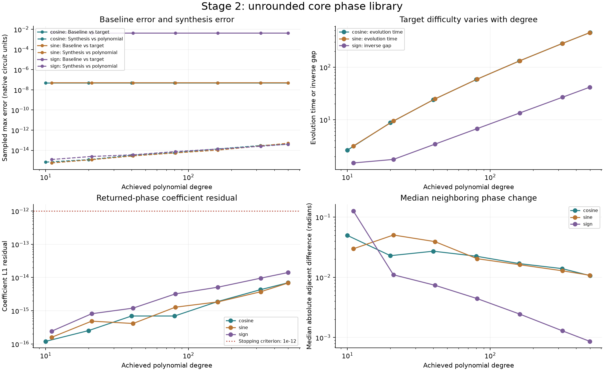
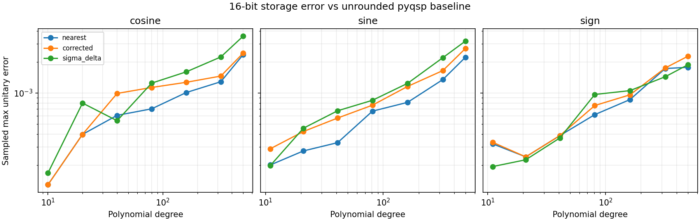

# Finite-Precision Phases in Quantum Signal Processing

**Anish Kumar · Professor Itay Hen**

The [original project description](references/QSP_project.docx) is the authoritative assignment. Check its stage requirements before new work; [Assignment Alignment](notes/Assignment%20Alignment.md) maps the required outputs, current boundaries, and deferred extensions.

## Project goal

Measure how storing quantum signal processing (QSP) phase angles at finite precision changes the accuracy of the realized circuit. Using phase lists from production solvers for realistic target functions, this classical numerical study will determine how rounding error scales with polynomial degree and bit precision, whether correlated errors approach coherent linear growth rather than square-root growth, and how noise-shaped quantization improves accuracy.

The study isolates phase-storage error. Solver approximation residuals, numerical evaluation error, and hardware gate-synthesis error must remain separate from this quantity.

## Core scope

- Generate Hamiltonian-simulation targets (cosine and sine via Jacobi–Anger approximations) and sign/step targets scaled to a maximum of 0.9.
- Use pyqsp's symmetric-QSP method as the default phase solver and QSPPACK as a cross-check.
- Cover degrees of approximately 10–500, spaced roughly logarithmically, and phase precisions of 12, 16, 20, 24, 28, and 32 bits.
- Compare nearest rounding, nearest rounding with a one-phase sum correction, and first-order sigma-delta noise shaping.
- Measure full-unitary, matrix-element, and application-readout error separately, including endpoint and interior behavior.
- Relate error scaling to phase plateaus, rounding-error autocorrelation, and the total variation of sensitivity profiles.
- Determine precision requirements and examine the practical 21-bit regime.

## Workflow and planned deliverables

1. **Forward evaluator and conventions:** implement vectorized QSP evaluation; reproduce solver response curves; validate unitarity, boundedness, and parity; document conventions.
2. **Phase library:** save full-double-precision phases with target parameters, degree, solver version, and approximation residual; plot representative phase sequences.
3. **Quantization:** generate rounded phase lists and record their error sequences.
4. **Measurements:** evaluate error on Chebyshev grids, record application-domain metrics, and spot-check high-degree cases with extended precision.
5. **Analysis:** produce scaling fits, correlation and location analyses, scheme comparisons, precision-budget plots, and an 8–12 page report.

**Checkpoint:** the original assignment calls for Professor Hen to review the convention note, reproduced solver output, and regenerable core phase library before Stage 3. That review remains pending; the user authorized the experimental Stage 3 run below in advance of it.

[The Stage 2 checkpoint guide](notes/Stage%202%20-%20Checkpoint%20Guide.md) collects the evidence and remaining original MATLAB requirement. A separate clone and new pinned environment regenerated all 21 Python cases: **maximum difference from the published phases and reconstructed curves was 0.0**, for both pyqsp and Python QSPPACK. [The rebuild comparison](results/stage2/rebuild_comparison.json) retains that result and its tested revision. The current **22 tests pass**, and all **104 identity checks pass**. The [artifact audit](results/stage2/artifact_audit.json) checks phase/data coverage, numerical reconstruction, hashes, 28 reference/diagnostic PNGs, and local documentation links. Original MATLAB execution is [recorded as unable to complete](results/stage2/matlab_execution_status.json); the [portable bundle](results/stage2/qsp-stage2-matlab.zip) remains ready for a working session. [Delivery note](notes/Stage%202%20-%20Delivery%20Note.md).

Extensions include scaled inversion, eigenstate/bandpass filters, degrees up to 2,000, decimal grids, dithering, and symmetry-preserving noise shaping. These follow a reproducible core result.

[Representative Stage 2 phase-angle plots](notes/Stage%202%20-%20Phase%20Structure.md) compare low, middle, and high degree for each family, with fixed edge zooms to inspect regions that look flat at full scale. They supplement the overview's median neighboring-difference summary; they do not measure rounding-error correlations.

## Stage map

Each stage gets its own code package and README under `src/qsp_finite_precision/`, with matching checks under `tests/stageN/`. Planned paths are created when their implementation begins; shared outputs retain the existing data/results/figures layout.

| Stage | Code and documentation | Scope | Status |
| --- | --- | --- | --- |
| 1 | [stage1/](src/qsp_finite_precision/stage1/README.md) | **Part A:** forward evaluator. **Part B:** pyqsp comparisons and solver-convention validation. | Complete for pinned Python packages; MATLAB source mapping documented |
| 2 | [stage2/](src/qsp_finite_precision/stage2/README.md) | Target polynomials, solver phases, metadata, data, and graphs | Python deliverables complete: 21 cases; original MATLAB unable to complete; supervisor checkpoint pending |
| 3 | [stage3.py](src/qsp_finite_precision/stage3.py) · [experiment guide](experiments/stage3/README.md) | Quantization schemes; rounded phases in `data/quantized/` | Experimental implementation and run complete; supervisor checkpoint pending |
| 4 | [exploratory measurements](results/stage3/measurements.csv) | Error measurements; tables in `results/` | Partial: sampled metrics saved; autocorrelation, sensitivity and high-precision checks remain |
| 5 | `src/qsp_finite_precision/stage5/` (planned) | Scaling analysis and plots; final writing in `report/` | Pending |

### Stage 1 quick start

From this repository's root, install the package and run the Part A checks:

```shell
python -m pip install -e .
python -m unittest discover -s tests/stage1 -v
```

```python
import numpy as np
from qsp_finite_precision.stage1 import evaluate_qsp

x = np.linspace(-1, 1, 101)
U, P = evaluate_qsp([0.2, 0.7, -0.4], x)
# U.shape == (101, 2, 2); P.shape == (101,)
```

The [Stage 1 README](src/qsp_finite_precision/stage1/README.md) contains the implementation diagrams and mathematical definitions. [The Stage 1B README](experiments/stage1/README.md) embeds reference graphs and error tables for the three built-in examples and linear diagnostic, plus the locked environment and regeneration commands for all 12 tests, 104 identity checks, and 16 Python QSPPACK convention comparisons.

<!-- BEGIN STAGE 2 RESULTS -->

## Stage 2 measured baseline results

**21/21 configured cases generated and independently reloaded**; 3,421 full-precision phases saved. No phases were quantized. The counts and metrics below come from the saved [manifest](results/stage2/summary.json) and [results CSV](results/stage2/library_summary.csv).

| Target | Cases | Degrees | Worst target error on application domain | Worst synthesis error on full interval |
| --- | ---: | --- | ---: | ---: |
| Cosine | 7 | 10–500 | 5.000e-08 | 3.915e-14 |
| Sine | 7 | 11–499 | 5.000e-08 | 5.007e-14 |
| Sign | 7 | 11–499 | 4.784e-03 | 4.019e-14 |

Errors above are sampled maxima in native scaled circuit units. Hamiltonian targets use scale 0.5; the sign target is 0.9 times sign(x) on each recorded gap-excluded domain. The sign polynomial is constructed from a smooth erf surrogate, but target errors are measured against the sign function itself. The target-accuracy acceptance goals (1e-6 for cosine/sine; 1e-2 for sign) are documented implementation choices, not tolerances specified by the professor.

All 21 returned-phase coefficient checks and supplementary Python QSPPACK checks passed. Maximum pyqsp/local complex-amplitude difference on the recorded audit grids: 0.000e+00. Reload verification checks archive hashes, full phase counts, reconstruction, and curve/metric consistency.



[Stage 2 implementation and results guide](src/qsp_finite_precision/stage2/README.md) · [Browse all cases, phase plots, and response/error graphs](data/phases/README.md) · [Regeneration commands](experiments/stage2/README.md)

**Python Stage 2 deliverables complete; original MATLAB cross-check unable to complete.** MATLAB Online failed before code execution; [the attempt record](results/stage2/matlab_execution_status.json) documents the limitation. MATLAB test code and publication tools are prepared, not executed evidence. Professor Hen's checkpoint remains pending.

<!-- END STAGE 2 RESULTS -->

## Stage 3 experimental results

The user authorized an experimental run before the pending supervisor checkpoint. We rounded 21 cosine, sine, and sign cases from each of two Python phase lists using three schemes and six bit depths: **756 configurations**. The [phase files](data/quantized/stage3/) retain grid words, rounded phases, error sequences and source hashes. The [results table](results/stage3/measurements.csv) and saved curves compare each rounded circuit with its own unrounded baseline on degree-dependent Chebyshev grids. Python QSPPACK is supplementary; original MATLAB was not run.

For the pyqsp degree-500 cosine case at 16 bits, sampled maximum unitary errors were 0.00235084 (nearest), 0.00243138 (last-phase sum correction), and 0.00355334 (sigma-delta). Sigma-delta's endpoint error bound does not guarantee an improvement in the global maximum. The maximum sampled 32-bit unitary error across all configurations was 5.61e-8. These are binary64 sampled observations, not continuous-domain guarantees or fixed-difficulty scaling results: target parameters vary with degree.



[Sign response comparison](figures/stage3/sign_response_comparison.png) · [Methods, conventions, verification and regeneration](experiments/stage3/README.md) · [Numerical results](results/stage3/measurements.csv)

The three Stage 3 tests and saved-output verifier passed, and a same-environment rerun reproduced phase JSON files and the CSV byte for byte. Full Stage 4 still needs autocorrelations, sensitivity profiles and 30-digit spot checks; Stage 5 analysis and the report remain open. The experimental run is not Professor Hen's approval.

## Repository layout

| Folder | Purpose |
| --- | --- |
| references/ | Original project description and PDF copy |
| notes/ | Research dashboard, conventions, decisions, and progress |
| notes/learning/ | Lessons from mathematical foundations through QSP and finite-precision analysis |
| src/qsp_finite_precision/ | Forward evaluator, core-library implementation and Stage 3 quantization |
| tests/ | Checks organized by stage |
| experiments/ | Experiment configurations and reproducibility instructions |
| data/phases/ | Full-precision phase library and metadata |
| data/quantized/ | Rounded phase lists and rounding errors |
| results/ | Measurement tables |
| figures/ | Generated analysis figures |
| report/ | Written research report |

Stage 1 is validated against pyqsp 0.2.0 and Python QSPPACK 0.4.0, with [response overlays](figures/stage1/solver_comparisons.png), [recorded metrics](results/stage1/solver_comparisons.json), and the [convention note](notes/Conventions.md). Stage 2 supplies the Python phase library. Stage 3 contains the experimental quantization run above. Original MATLAB execution and the supervisor checkpoint remain pending; finite-precision scaling analysis has not yet been completed.

## Project description

- [Project description (PDF)](references/QSP_project.pdf)
- [Original email attachment (DOCX)](references/QSP_project.docx)

Professor Itay Hen authored the project description, dated September 26, 2026. The email attachment was a DOCX; the PDF is a local export of that document.

## Obsidian and Git

Open this repository folder as an Obsidian vault, then open [the research dashboard](notes/Home.md). The vault includes the [Minimal theme](https://github.com/kepano/obsidian-minimal) by kepano, with its upstream MIT license, and the existing Vault Git plugin.

In Obsidian's Command Palette use **Vault Git: Pull** before editing and **Vault Git: Commit and push** after editing. The plugin uses this vault folder's Git repository and origin; credentials are provided by the existing GitHub CLI authentication. Workspace layout, caches, and local secrets are excluded from version control.

The GitHub repository is public and owned by AnishKumar-gesgts2. GitHub displays contributor activity after an account authors commits.
