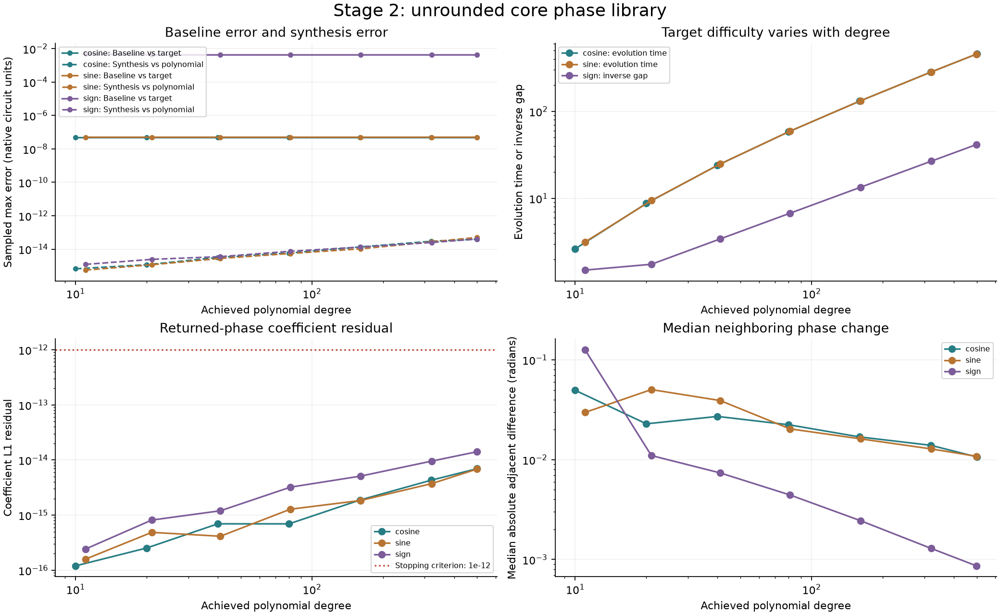
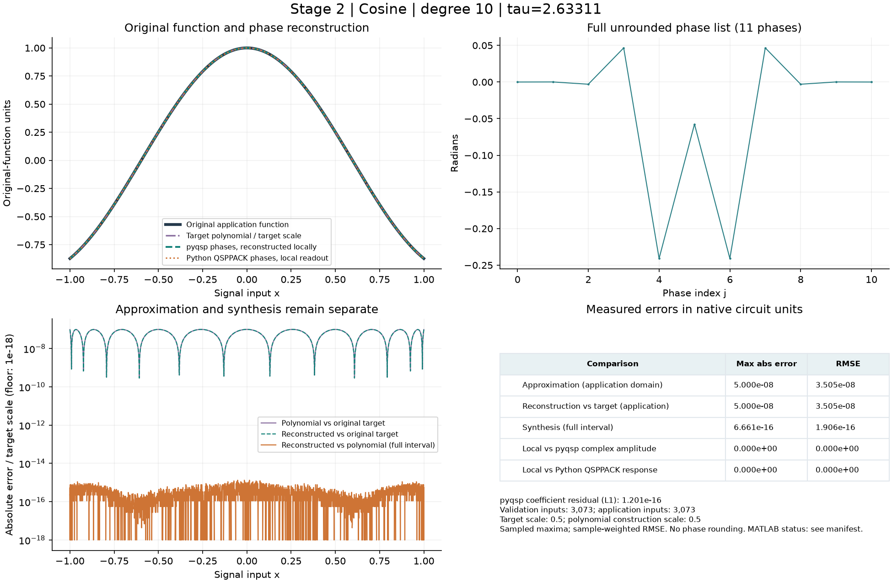
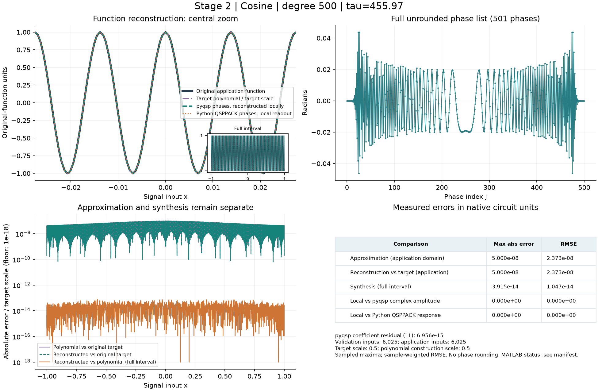
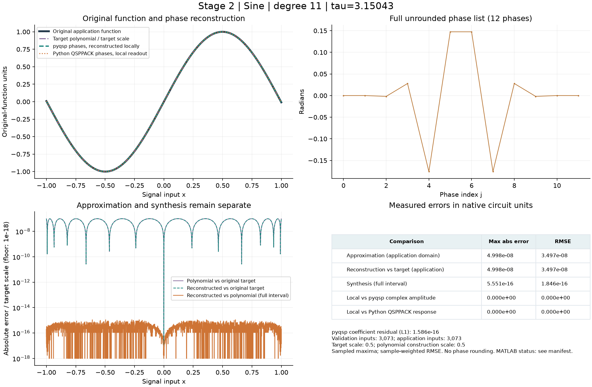
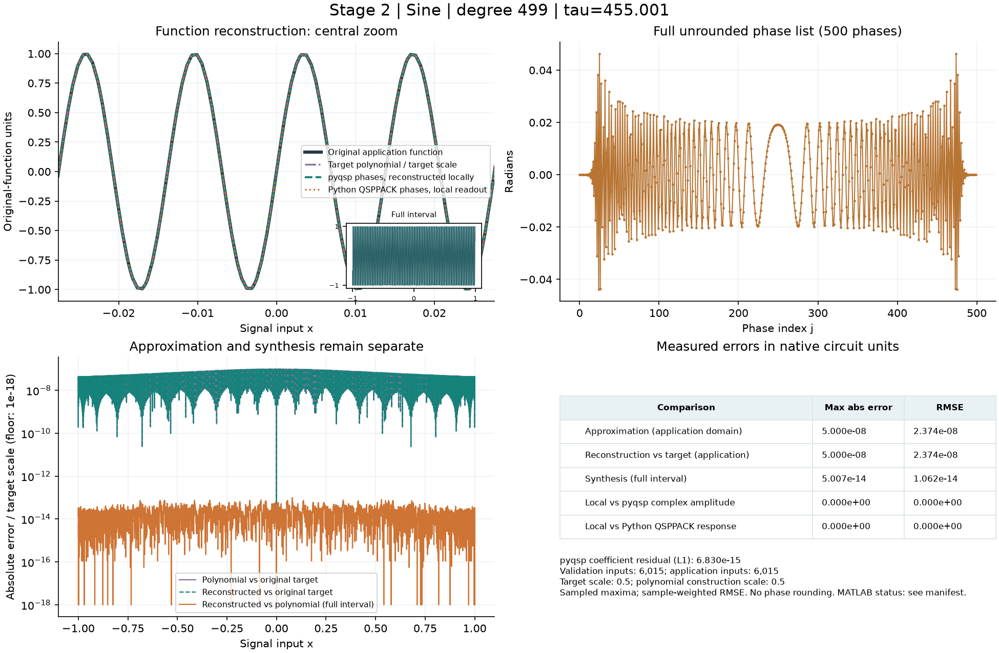
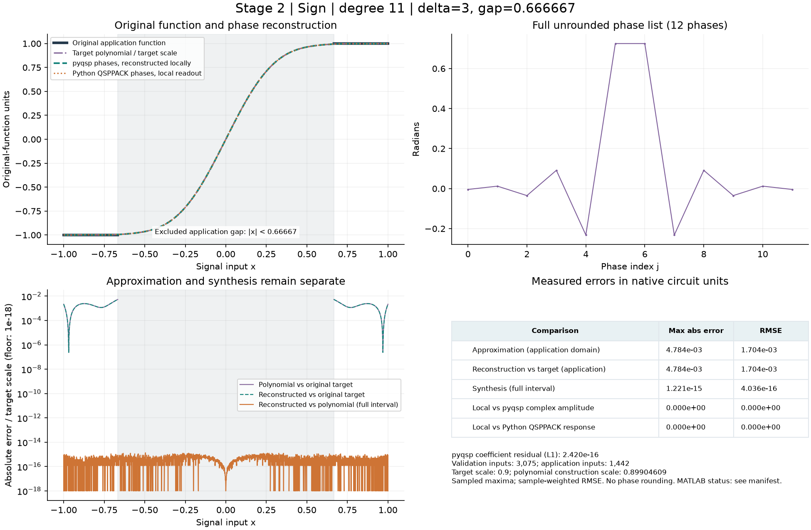
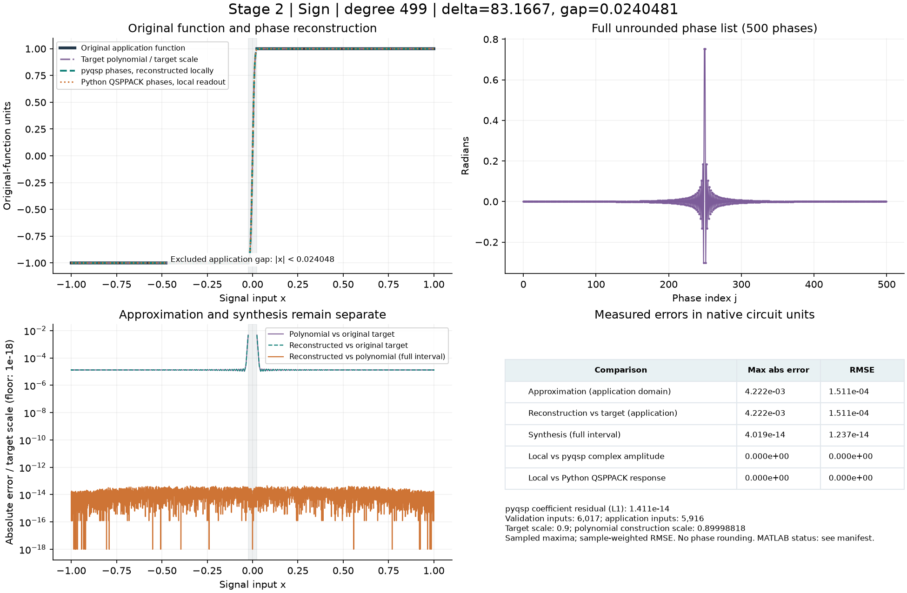

# Full-precision core phase library

Generated Stage 2 Python baselines. All angles are in radians, unwrapped and unquantized, saved as round-trip binary64 JSON numbers. Only cases listed in the [manifest](../../results/stage2/summary.json) belong to this generated library.

Python library complete; original MATLAB cross-check unavailable in this environment; supervisor review pending. [Methods and acceptance criteria](../../src/qsp_finite_precision/stage2/README.md) · [Regenerate / verify](../../experiments/stage2/README.md)

Each case graph includes the original target, target polynomial, phase-reconstructed response, full phase list, separate error curves, and max/RMSE table. Response curves are displayed in original-function units; figure tables and the summary below retain native scaled circuit units. For sign cases the excluded application gap is shaded.

| Case | Degree | Parameter | Max target error | Max synthesis error | Artifacts |
| --- | ---: | --- | ---: | ---: | --- |
| cosine_d0010 | 10 | tau=2.6331 | 5.000e-08 | 6.661e-16 | [Phases](stage2/cosine_d0010.json) · [Graph](../../figures/stage2/cosine_d0010.png) · [Curves CSV](../../results/stage2/cosine_d0010_response.csv) |
| cosine_d0020 | 20 | tau=8.7498 | 5.000e-08 | 1.166e-15 | [Phases](stage2/cosine_d0020.json) · [Graph](../../figures/stage2/cosine_d0020.png) · [Curves CSV](../../results/stage2/cosine_d0020_response.csv) |
| cosine_d0040 | 40 | tau=23.995 | 5.000e-08 | 3.164e-15 | [Phases](stage2/cosine_d0040.json) · [Graph](../../figures/stage2/cosine_d0040.png) · [Curves CSV](../../results/stage2/cosine_d0040_response.csv) |
| cosine_d0080 | 80 | tau=58.237 | 5.000e-08 | 5.829e-15 | [Phases](stage2/cosine_d0080.json) · [Graph](../../figures/stage2/cosine_d0080.png) · [Curves CSV](../../results/stage2/cosine_d0080_response.csv) |
| cosine_d0160 | 160 | tau=131.22 | 5.000e-08 | 1.349e-14 | [Phases](stage2/cosine_d0160.json) · [Graph](../../figures/stage2/cosine_d0160.png) · [Curves CSV](../../results/stage2/cosine_d0160_response.csv) |
| cosine_d0320 | 320 | tau=282.59 | 5.000e-08 | 2.948e-14 | [Phases](stage2/cosine_d0320.json) · [Graph](../../figures/stage2/cosine_d0320.png) · [Curves CSV](../../results/stage2/cosine_d0320_response.csv) |
| cosine_d0500 | 500 | tau=455.97 | 5.000e-08 | 3.915e-14 | [Phases](stage2/cosine_d0500.json) · [Graph](../../figures/stage2/cosine_d0500.png) · [Curves CSV](../../results/stage2/cosine_d0500_response.csv) |
| sine_d0011 | 11 | tau=3.1504 | 4.998e-08 | 5.551e-16 | [Phases](stage2/sine_d0011.json) · [Graph](../../figures/stage2/sine_d0011.png) · [Curves CSV](../../results/stage2/sine_d0011_response.csv) |
| sine_d0021 | 21 | tau=9.4443 | 4.998e-08 | 1.166e-15 | [Phases](stage2/sine_d0021.json) · [Graph](../../figures/stage2/sine_d0021.png) · [Curves CSV](../../results/stage2/sine_d0021_response.csv) |
| sine_d0041 | 41 | tau=24.808 | 4.998e-08 | 2.776e-15 | [Phases](stage2/sine_d0041.json) · [Graph](../../figures/stage2/sine_d0041.png) · [Curves CSV](../../results/stage2/sine_d0041_response.csv) |
| sine_d0081 | 81 | tau=59.124 | 4.998e-08 | 5.496e-15 | [Phases](stage2/sine_d0081.json) · [Graph](../../figures/stage2/sine_d0081.png) · [Curves CSV](../../results/stage2/sine_d0081_response.csv) |
| sine_d0161 | 161 | tau=132.15 | 4.989e-08 | 1.044e-14 | [Phases](stage2/sine_d0161.json) · [Graph](../../figures/stage2/sine_d0161.png) · [Curves CSV](../../results/stage2/sine_d0161_response.csv) |
| sine_d0321 | 321 | tau=283.55 | 5.000e-08 | 2.731e-14 | [Phases](stage2/sine_d0321.json) · [Graph](../../figures/stage2/sine_d0321.png) · [Curves CSV](../../results/stage2/sine_d0321_response.csv) |
| sine_d0499 | 499 | tau=455 | 5.000e-08 | 5.007e-14 | [Phases](stage2/sine_d0499.json) · [Graph](../../figures/stage2/sine_d0499.png) · [Curves CSV](../../results/stage2/sine_d0499_response.csv) |
| sign_d0011 | 11 | gap=0.66667; delta=3 | 4.784e-03 | 1.221e-15 | [Phases](stage2/sign_d0011.json) · [Graph](../../figures/stage2/sign_d0011.png) · [Curves CSV](../../results/stage2/sign_d0011_response.csv) |
| sign_d0021 | 21 | gap=0.57143; delta=3.5 | 4.219e-03 | 2.442e-15 | [Phases](stage2/sign_d0021.json) · [Graph](../../figures/stage2/sign_d0021.png) · [Curves CSV](../../results/stage2/sign_d0021_response.csv) |
| sign_d0041 | 41 | gap=0.29268; delta=6.8333 | 4.215e-03 | 3.553e-15 | [Phases](stage2/sign_d0041.json) · [Graph](../../figures/stage2/sign_d0041.png) · [Curves CSV](../../results/stage2/sign_d0041_response.csv) |
| sign_d0081 | 81 | gap=0.14815; delta=13.5 | 4.216e-03 | 7.438e-15 | [Phases](stage2/sign_d0081.json) · [Graph](../../figures/stage2/sign_d0081.png) · [Curves CSV](../../results/stage2/sign_d0081_response.csv) |
| sign_d0161 | 161 | gap=0.074534; delta=26.833 | 4.222e-03 | 1.332e-14 | [Phases](stage2/sign_d0161.json) · [Graph](../../figures/stage2/sign_d0161.png) · [Curves CSV](../../results/stage2/sign_d0161_response.csv) |
| sign_d0321 | 321 | gap=0.037383; delta=53.5 | 4.222e-03 | 2.498e-14 | [Phases](stage2/sign_d0321.json) · [Graph](../../figures/stage2/sign_d0321.png) · [Curves CSV](../../results/stage2/sign_d0321_response.csv) |
| sign_d0499 | 499 | gap=0.024048; delta=83.167 | 4.222e-03 | 4.019e-14 | [Phases](stage2/sign_d0499.json) · [Graph](../../figures/stage2/sign_d0499.png) · [Curves CSV](../../results/stage2/sign_d0499_response.csv) |

## Cosine reference examples

### cosine_d0010

### cosine_d0500

## Sine reference examples

### sine_d0011

### sine_d0499

## Sign reference examples

### sign_d0011

### sign_d0499

