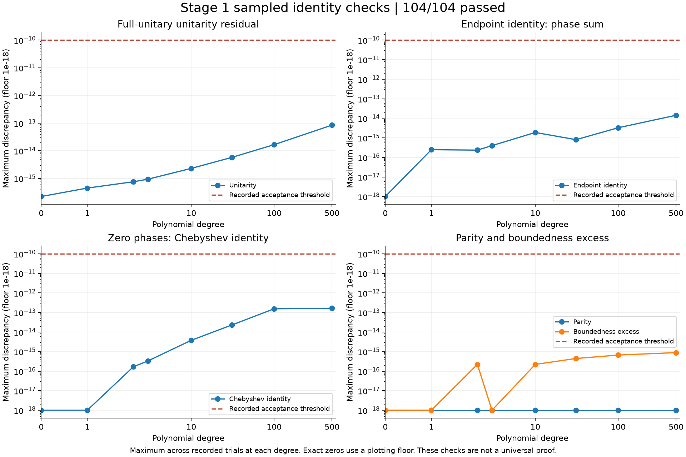
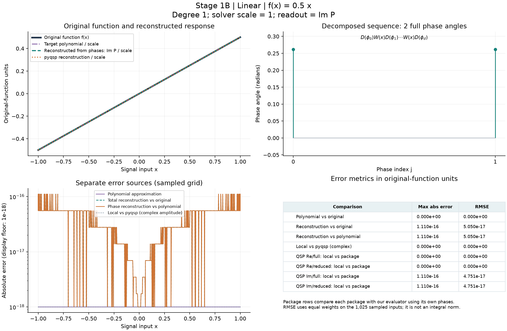
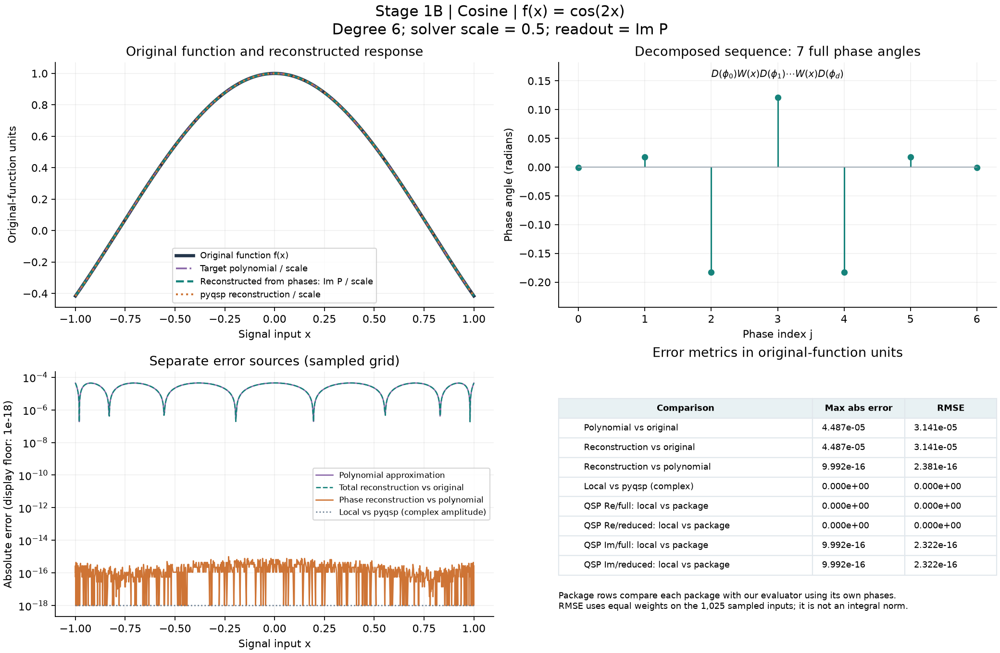
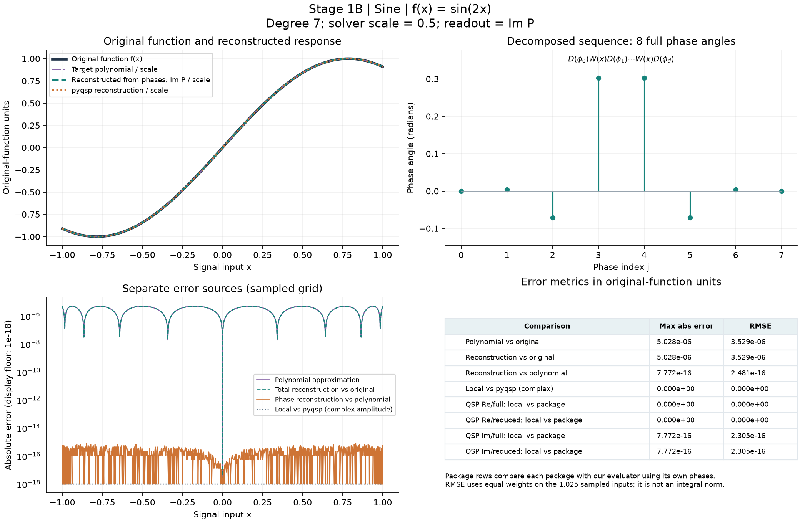
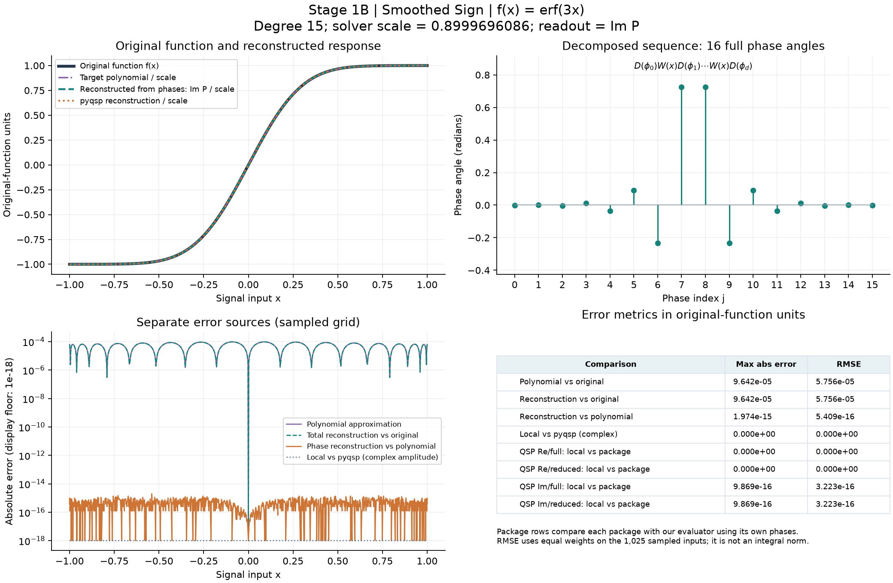

# Stage 1B: solver comparisons and reference graphs

Use Python 3.11. The recorded run used Python 3.11.9, pyqsp 0.2.0, Python QSPPACK 0.4.0, NumPy 2.4.6, SciPy 1.17.1, and Matplotlib 3.11.2. The report records the actual interpreter version; the lock captures the resolved dependencies for this Windows environment.

From the repository root in PowerShell:

```powershell
python -m venv .venv
.\.venv\Scripts\python.exe -m pip install -r experiments/stage1/requirements.lock.txt -e ".[validation]"
.\.venv\Scripts\python.exe -m unittest discover -s tests/stage1 -v
.\.venv\Scripts\python.exe experiments/stage1/check_identities.py
.\.venv\Scripts\python.exe experiments/stage1/plot_identities.py
.\.venv\Scripts\python.exe experiments/stage1/compare_solvers.py
```

The optional `validation` extra keeps solver and plotting dependencies out of the core evaluator. Without it, package-integration tests are explicitly skipped; that is not a full validation run.

## Comparison design

### Mathematical identity checks

The [identity CSV](../../results/stage1/mathematical_checks.csv) contains 104 passing checks through degree 500. The graph below reports the largest recorded discrepancy at each degree for unitarity, the endpoint phase-sum identity, the zero-phase Chebyshev identity, parity, and boundedness excess. The dashed line is the recorded acceptance threshold. Exact zeros use a labeled plotting floor; the CSV retains zero. These sampled binary64 checks support implementation validation, not an all-input proof or a numerical error-floor certificate.



`compare_solvers.py` uses the built-in `PolyCosineTX(tau=2, epsilon=1e-3)`, `PolySineTX` with the same arguments, and `PolySign(degree=15, delta=3, max_scale=0.9)` generators, plus the explicit linear diagnostic `0.5x`. It records their actual coefficients and scales. The sign generator uses an erf surrogate; the core sign-domain phase library remains Stage 2 work.

For each example, the same full phases and input array go to our evaluator and pyqsp. The full complex upper-left entries are compared **before** taking the imaginary target readout. The full unitary is also compared with `SymmetricQSPProtocol.gen_unitary`. The input grid combines 513 Chebyshev-Lobatto points (central point set to exact zero) and 512 uniform interior midpoints: 1,025 points including both endpoints.

Python QSPPACK synthesizes the same polynomial using Newton with `criteria=1e-12`, `maxiter=100`. Every combination of `targetPre=True/False` and `typePhi='full'/'reduced'` is compared with its own `get_entry` response using our mapped full phase list: 16 mappings across four examples. The script checks convergence and that evaluation leaves phase inputs unchanged. Additional integration tests cover nonsymmetric phases, the measurement-basis distinction, even/odd reduced expansion, and degree zero.

<!-- BEGIN REFERENCE GRAPHS -->

## Reference graphs and error metrics

Every graph includes the original function, target polynomial, response reconstructed from the synthesized phases, the full phase sequence, and separate error curves. The function curves and tables below use original-function units: divide the polynomial and reconstructed readouts by the recorded generator scale. This is a display conversion, not an additional quantum operation. QSPPACK function-accuracy rows use its synthesized phases reconstructed by our evaluator; separate agreement rows compare that reconstruction with the package's own response. Native scaled metrics and all phases remain in the JSON report.

Max error and RMSE are sampled statistics on the same 1,025-point grid. RMSE gives equal weight to each sampled point; because the grid is nonuniform, it is not a uniform-domain integral norm. Exact zero errors use a labeled plotting floor of `1e-18`; tables retain zero.

### Linear

Original reference: f(x) = 0.5 x. Degree **1**; generator scale **1**.



| Response vs original function | Max absolute error | RMSE |
| --- | ---: | ---: |
| Target polynomial / scale | 0.000000e+00 | 0.000000e+00 |
| Our phase reconstruction / scale | 1.110223e-16 | 5.050008e-17 |
| pyqsp reconstruction / scale | 1.110223e-16 | 5.050008e-17 |
| QSPPACK real, full / scale | 1.110223e-16 | 6.087716e-17 |
| QSPPACK real, reduced / scale | 1.110223e-16 | 6.087716e-17 |
| QSPPACK imaginary, full / scale | 5.551115e-17 | 2.960359e-17 |
| QSPPACK imaginary, reduced / scale | 5.551115e-17 | 2.960359e-17 |

| Reconstruction / evaluator check | Max absolute error | RMSE |
| --- | ---: | ---: |
| Our reconstruction vs polynomial | 1.110223e-16 | 5.050008e-17 |
| Local vs pyqsp (complex) | 0.000000e+00 | 0.000000e+00 |
| QSP Re/full: local vs package | 0.000000e+00 | 0.000000e+00 |
| QSP Re/reduced: local vs package | 0.000000e+00 | 0.000000e+00 |
| QSP Im/full: local vs package | 1.110223e-16 | 4.751311e-17 |
| QSP Im/reduced: local vs package | 1.110223e-16 | 4.751311e-17 |

### Cosine

Original reference: f(x) = cos(2x). Degree **6**; generator scale **0.5**.



| Response vs original function | Max absolute error | RMSE |
| --- | ---: | ---: |
| Target polynomial / scale | 4.486607e-05 | 3.141095e-05 |
| Our phase reconstruction / scale | 4.486607e-05 | 3.141095e-05 |
| pyqsp reconstruction / scale | 4.486607e-05 | 3.141095e-05 |
| QSPPACK real, full / scale | 4.486607e-05 | 3.141095e-05 |
| QSPPACK real, reduced / scale | 4.486607e-05 | 3.141095e-05 |
| QSPPACK imaginary, full / scale | 4.486607e-05 | 3.141095e-05 |
| QSPPACK imaginary, reduced / scale | 4.486607e-05 | 3.141095e-05 |

| Reconstruction / evaluator check | Max absolute error | RMSE |
| --- | ---: | ---: |
| Our reconstruction vs polynomial | 9.992007e-16 | 2.381029e-16 |
| Local vs pyqsp (complex) | 0.000000e+00 | 0.000000e+00 |
| QSP Re/full: local vs package | 0.000000e+00 | 0.000000e+00 |
| QSP Re/reduced: local vs package | 0.000000e+00 | 0.000000e+00 |
| QSP Im/full: local vs package | 9.992007e-16 | 2.322137e-16 |
| QSP Im/reduced: local vs package | 9.992007e-16 | 2.322137e-16 |

### Sine

Original reference: f(x) = sin(2x). Degree **7**; generator scale **0.5**.



| Response vs original function | Max absolute error | RMSE |
| --- | ---: | ---: |
| Target polynomial / scale | 5.028184e-06 | 3.529068e-06 |
| Our phase reconstruction / scale | 5.028184e-06 | 3.529068e-06 |
| pyqsp reconstruction / scale | 5.028184e-06 | 3.529068e-06 |
| QSPPACK real, full / scale | 5.028184e-06 | 3.529068e-06 |
| QSPPACK real, reduced / scale | 5.028184e-06 | 3.529068e-06 |
| QSPPACK imaginary, full / scale | 5.028184e-06 | 3.529068e-06 |
| QSPPACK imaginary, reduced / scale | 5.028184e-06 | 3.529068e-06 |

| Reconstruction / evaluator check | Max absolute error | RMSE |
| --- | ---: | ---: |
| Our reconstruction vs polynomial | 7.771561e-16 | 2.481255e-16 |
| Local vs pyqsp (complex) | 0.000000e+00 | 0.000000e+00 |
| QSP Re/full: local vs package | 0.000000e+00 | 0.000000e+00 |
| QSP Re/reduced: local vs package | 0.000000e+00 | 0.000000e+00 |
| QSP Im/full: local vs package | 7.771561e-16 | 2.305171e-16 |
| QSP Im/reduced: local vs package | 7.771561e-16 | 2.305171e-16 |

### Smoothed Sign

Original reference: f(x) = erf(3x). Degree **15**; generator scale **0.8999696086**.



| Response vs original function | Max absolute error | RMSE |
| --- | ---: | ---: |
| Target polynomial / scale | 9.642211e-05 | 5.755639e-05 |
| Our phase reconstruction / scale | 9.642211e-05 | 5.755639e-05 |
| pyqsp reconstruction / scale | 9.642211e-05 | 5.755639e-05 |
| QSPPACK real, full / scale | 9.642211e-05 | 5.755639e-05 |
| QSPPACK real, reduced / scale | 9.642211e-05 | 5.755639e-05 |
| QSPPACK imaginary, full / scale | 9.642211e-05 | 5.755639e-05 |
| QSPPACK imaginary, reduced / scale | 9.642211e-05 | 5.755639e-05 |

| Reconstruction / evaluator check | Max absolute error | RMSE |
| --- | ---: | ---: |
| Our reconstruction vs polynomial | 1.973796e-15 | 5.409292e-16 |
| Local vs pyqsp (complex) | 0.000000e+00 | 0.000000e+00 |
| QSP Re/full: local vs package | 0.000000e+00 | 0.000000e+00 |
| QSP Re/reduced: local vs package | 0.000000e+00 | 0.000000e+00 |
| QSP Im/full: local vs package | 9.868982e-16 | 3.223295e-16 |
| QSP Im/reduced: local vs package | 9.868982e-16 | 3.223295e-16 |

The original reference for this built-in test is the smooth function `erf(3x)`. This graph does not claim uniform approximation of discontinuous `sign(x)`; the gap-domain sign specification belongs to Stage 2.

<!-- END REFERENCE GRAPHS -->

## Outputs and thresholds

- `results/stage1/mathematical_checks.csv`: 104 sampled identity checks through degree 500.
- `results/stage1/solver_comparisons.json`: example definitions, phases, versions, hashes, convergence, native scaled residuals, and maximum/RMSE metrics in original-function units.
- `results/stage1/solver_responses.csv`: original functions, target and response samples, and per-input errors, including all four QSPPACK readouts.
- `results/stage1/solver_output.log`: pyqsp's generator and Newton iteration output.
- `figures/stage1/solver_comparisons.png`: response overlays and residuals. Exact zeros are displayed at a labeled plotting floor of `1e-18`.
- `figures/stage1/{linear,cosine,sine,smoothed_sign}_reference.png`: one four-panel reference graph per example, with original/reconstructed functions, full phases, separated error curves, and metric tables. These are embedded above and regenerated with the script.

The evaluator-comparison/structural threshold is `5e-13`, conservative for these degree-1/6/7/15 binary64 products. The evaluated polynomial-residual threshold is separately `1e-10`; the coefficient one-norm stopping threshold is `1e-12`. These are regression acceptance thresholds in the native scaled circuit units, not observed error floors or rigorous error bounds. Measured discrepancies are reported individually. Polynomial-vs-smooth-function error is recorded separately and is not required to be as small as the solver residual.

The four examples are validation fixtures, not the Stage 2 library. MATLAB QSPPACK was source-inspected, not executed; Python QSPPACK does not replace the planned MATLAB numerical cross-check. No phases are rounded. Package comparisons do not establish high-degree numerical accuracy; the existing degree-500 identity checks address a different, sampled validation question.

See [Conventions](../../notes/Conventions.md) for the explicit mappings and source references.
