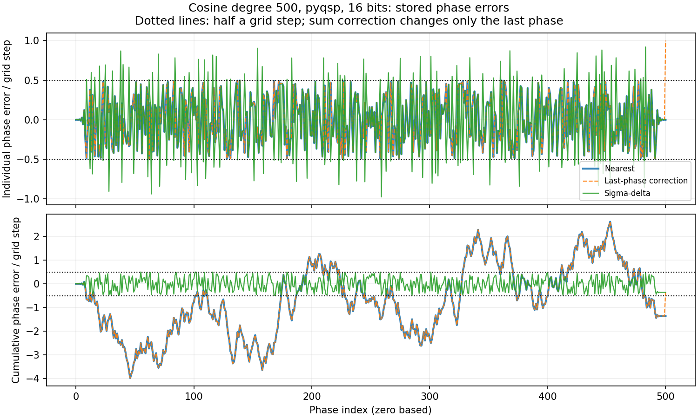
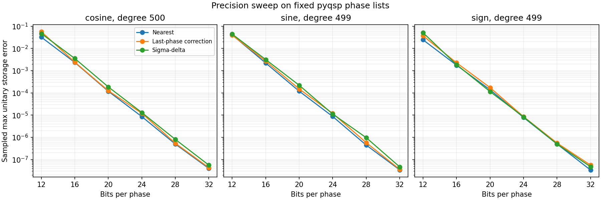

# Phase quantization experiment

This is the user-authorized experimental implementation of Stage 3, performed while the Stage 2 supervisor checkpoint remains pending. Original MATLAB QSPPACK did not run. Neither this work nor the user's authorization is supervisor approval. The original assignment `references/QSP_project.docx`, Stage 3 and Stage 4, was reread for this experiment. Stage 3 calls for six binary grids spanning one turn, nearest, last-phase sum correction, and first-order sigma-delta, with saved phase-error sequences. We additionally apply all schemes to supplementary Python QSPPACK phase lists as well as primary pyqsp lists. No decimal grid, dithering, or symmetry-preserving extension is included.

From the repository root, with Python, NumPy and Matplotlib installed:

```powershell
python -m unittest discover -s tests/stage3 -v
python experiments/stage3/run.py
python experiments/stage3/verify.py
```

To refresh only the two additional diagnostic figures and interpretation tables from the saved results, run `python experiments/stage3/summarize.py`. The full generator also calls this step automatically.

## Stage 3 requirement check

The core quantization outputs are complete for the available Stage 2 library. The original specification remains available locally; its Stage 3 output requirement is rounded phase files for every target, degree, grid, and scheme.

| Requirement | Saved evidence |
| --- | --- |
| Every core phase list | 21 target/degree cases, with the primary pyqsp list and supplementary Python QSPPACK list for each case |
| Six binary phase grids | 12, 16, 20, 24, 28, and 32 bits spanning one full turn |
| Three schemes | Nearest, nearest plus last-phase sum correction, and first-order sigma-delta |
| Ordered phase errors and rounded files | 756 JSON files, including phase words, rounded angles, error sequences, source hashes, and conventions |
| Reproducible implementation | Generator, saved-output verifier, three unit tests, and the commands above |

Decimal grids and dithering are optional extensions, so they are not needed to complete core Stage 3. The pending review checkpoint and original MATLAB check are separate limitations; this table reports the completed experimental quantization work.

The recorded run used Python 3.11.9, NumPy 2.3.3, Matplotlib 3.10.6 on the same machine as the check; this is not the Stage 2 pinned environment. The generator verifies baseline files against the Stage 2 manifest before using them. It overwrites its own Stage 3 generated outputs. A same-environment second run produced identical bytes for all 756 phase JSON files and the measurement CSV (aggregate SHA-256 `47c393476c7fdd81a81eadb52c2408cdd5c09f4434638e79eebb6f7cb5e43a3f`). Cross-platform reproducibility and image-byte identity were not tested.

Each [phase file](../../data/quantized/stage3/) stores words, rounded radians, phase errors, baseline path/hash, and conventions. The grid is `2*pi*k/2**bits` with integer words `0 <= k < 2**bits`. First reduce each original phase modulo `2*pi`. Compute errors as unwrapped grid output minus this wrapped input; integer lifts are retained during correction and noise shaping, and only final words are wrapped. Consequently errors are local representatives even when a word crosses zero. Exact half-grid ties round toward positive infinity in unwrapped grid coordinates. All calculations use binary64, so inputs numerically close to a tie follow the actually represented values.

For correction, direct rounding is followed by changing only the last integer word to make the total error as close to zero as the grid permits; an arbitrary total cannot be preserved exactly on a discrete grid. This last phase may move by multiple grid steps. Sigma-delta feeds the previous input-minus-output residual into the next phase; every cumulative error is bounded by half a step up to floating-point roundoff. No claim of symmetry preservation is made.

The [measurements CSV](../../results/stage3/measurements.csv) has 756 configurations, covering 21 baseline cases, two Python phase lists, six bits and three schemes. The [curve archives](../../results/stage3/) preserve sampled readouts and three per-point error metrics, with configuration order in metadata. Use `max(10*degree+1, 1025)` Chebyshev-Lobatto points, adding exact sign-gap edges. Results compare rounded and unrounded circuits, not circuits with the target function. The CSV separately reports sampled maxima of full-unitary operator norm, complex upper-left amplitude, and solver-specific readout, both globally and over the target's application domain. SU(2) first-row evaluation was checked against the existing full-matrix evaluator. Sign gap and evolution time vary with degree; degree trends are not fixed-difficulty scaling studies.

Four figures are generated from saved measurements and phase errors: [16-bit unitary error by degree](../../figures/stage3/unitary_error_16bit.png), [a degree-161 sign response comparison](../../figures/stage3/sign_response_comparison.png), [individual and cumulative rounding errors](../../figures/stage3/rounding_diagnostics.png), and [a precision sweep on fixed phase lists](../../figures/stage3/precision_sweep.png). For example, at 16 bits and degree 500 cosine, sampled pyqsp maximum unitary errors are 0.002351, 0.002431, and 0.003553 for nearest, corrected, and sigma-delta; sigma-delta is not uniformly better for the global maximum. The maximum 32-bit unitary error over all configurations was 5.61e-8. These are sampled observations, not accuracy guarantees or a scaling conclusion.

## Interpretation of the saved experiment



Nearest rounding bounds each individual error by half a grid step, but its cumulative error can drift. Last-phase correction follows that same cumulative trace until the final phase, where it reduces the total error to within half a step; this can make the last individual error larger. Sigma-delta limits every cumulative error to half a step, while individual errors can approach a full step. The nearest and corrected curves therefore overlap until the final correction in this example.

Across all cases and precisions, the largest sigma-delta cumulative error was 0.499937 grid steps. The largest absolute corrected total error was 0.499430 grid steps. These measured invariants agree with the quantizer behavior we intended. They constrain the phase-error sum, which controls endpoint unitary error; the circuit's interior response also depends on where the errors occur. Consequently, smaller accumulated phase error does not ensure a smaller maximum output error across the whole signal interval.



Within all 126 matching case/solver/scheme groups, 32-bit storage had smaller sampled maximum unitary error than 12-bit storage. The precision sweep holds each phase list fixed while varying only its bit depth. The displayed high-degree examples show a strong decrease with increasing precision, but this does not establish a universal monotonicity guarantee or a degree-scaling exponent. The scheme rankings vary, and the results do not support a claim that sigma-delta uniformly improves the global maximum.

The [quantization diagnostics CSV](../../results/stage3/quantization_diagnostics.csv) records normalized individual, prefix, and total phase-error measurements and the endpoint error predicted by the total sum for all 756 configurations. The [interpretation summary](../../results/stage3/interpretation.json) records the aggregate comparisons above. These tables are derived from the saved artifacts without rerunning circuit evaluation.

Executed checks: three unit tests passed; the verifier checked all 756 outputs and CSV maxima, phase bounds and endpoints. The maximum difference from the endpoint identity was 8.48e-14; selected degree-499/500, 32-bit sigma-delta samples differed from the independent full-matrix evaluator by at most 3.30e-15. The plotted values come directly from these saved CSV and curve arrays; the figures were visually inspected. This is binary64 evidence, not the required 30-digit high-degree spot check.

Stage 4 remains incomplete: normalized error autocorrelations, sensitivity profiles and their total variation, and 30-digit mpmath checks are not computed. Stage 5 scaling fits, predictors, endpoint/interior comparisons, precision thresholds including 21-bit, and the final report remain open. Sampled maxima may miss between-grid extrema, and finite precision limits interpretation of very small differences. Solver approximation and baseline errors remain separate in the Stage 2 archives.
