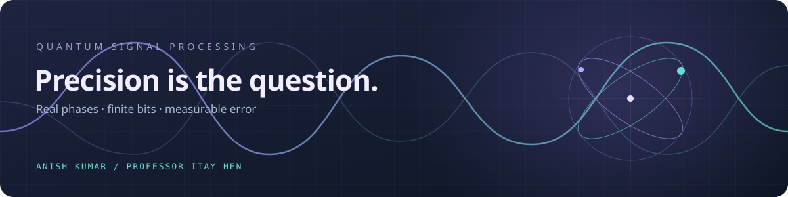

---
cssclasses:
  - qsp-dashboard
---

# Quantum Studio

Finite-precision phases in QSP · Anish Kumar & Professor Itay Hen

> [!focus] On the desk · Stage 01
> **Build the foundation.** Understand the phase conventions and create a validated forward evaluator.
>
> Next milestone → reproduce solver response curves and document the convention in [[Conventions]].

> [!map] Explore the workspace
> - [[../README|Project overview]] · goals & methods
> - [[../references/QSP_project.pdf|Research brief]] · the original project
> - [[Roadmap|Project roadmap]] · milestones & checkpoint
> - [[Conventions|Convention notebook]] · algebra & solver mappings
> - [[Research Log|Research journal]] · observations & decisions
> - [[templates/Experiment Note|Experiment template]] · repeatable records

## From phases to evidence

| Stage | Work | Deliverable |
| :--- | :--- | :--- |
| **01 / Evaluate** | Validate QSP and solver conventions | Forward evaluator + convention note |
| **02 / Generate** | Build realistic core phase lists | Phase library + solver residuals |
| **03 / Quantize** | Compare three rounding schemes | Rounded phases + error sequences |
| **04 / Measure** | Separate unitary, element, and readout errors | Measurement tables |
| **05 / Explain** | Study scaling and precision requirements | Figures + research report |

> [!pipeline] Before quantization
> Review the convention note, solver reproductions, and regenerable phase library with Professor Hen at the Stage 2 checkpoint.

## Questions that drive the work

> [!question] How do errors accumulate?
> Does the error scale linearly with degree, or like its square root? Do phase plateaus and rounding correlations explain the difference?

> [!question] What can better rounding buy?
> Where does maximum error occur? How much does noise shaping help, and how many bits are needed to meet the target accuracy—including the 21-bit case?

---

**Working rhythm** · Pull before editing → record the experiment → commit and push when ready.
