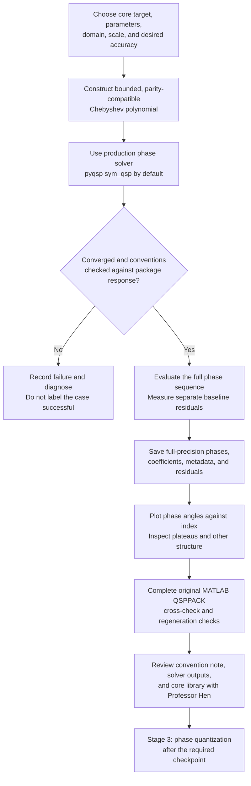

# Stage 2 — Phase Library Concept

**Status: implementation authorized by Anish on 2026-10-23. The Python workflow now generates and verifies 21 core baseline cases; original MATLAB execution and the supervisor checkpoint remain pending.** See [implementation and results](../src/qsp_finite_precision/stage2/README.md), [the library index](../data/phases/README.md), and [the measurable README summary](../README.md#stage-2-measured-baseline-results). The explanations below describe the concepts and requirements; they do not establish completion of the remaining checkpoint.

Source: Professor Itay Hen's [original project description](../references/QSP_project.docx), sections “Stage 2: a library of real phase lists” and “Checkpoint,” reviewed on 2026-10-23. The [PDF export](../references/QSP_project.pdf) contains the same assignment. The requirements below come from that description; proposed implementation choices are labeled separately.

## Goal and connection to the research question

Build a reproducible library of full-double-precision phase lists produced by established solvers for the two required target families. These lists will be the unrounded baselines used to measure phase-storage error in later stages.

The research question concerns how rounding errors accumulate on realistic solver output: whether errors add coherently, partly cancel, and respond differently to quantization schemes. Stage 2 supplies the realistic cases and records their existing approximation and synthesis errors before rounding begins.

## The objects we need to keep separate

$$
f(x)\longrightarrow p_d(x)\longrightarrow\Phi
\longrightarrow r_\Phi(x).
$$

| Object | Meaning | What we must know |
| --- | --- | --- |
| $f(x)$ | Desired target, including its chosen amplitude scale | Family, parameters, domain, and scale |
| $p_d(x)$ | Finite-degree polynomial approximating that target | Chebyshev coefficients, parity, boundedness, and approximation error |
| $\Phi=(\phi_0,\ldots,\phi_d)$ | Full phase sequence produced by a solver | All $d+1$ angles, solver convention, version, options, and convergence |
| $r_\Phi(x)$ | Real response reconstructed by the forward evaluator | Which component carries the target and its measured residual |

For pyqsp's symmetric method in our circuit convention,

$$
r_\Phi(x)=\operatorname{Im}\bigl([U_\Phi(x)]_{00}\bigr).
$$

The full complex amplitude and full unitary remain available for later error measurements. Matching a real target does not mean the whole complex amplitude equals that target.

## The two required target families

| Family | Targets | Parameter to vary | Construction / domain concern |
| --- | --- | --- | --- |
| Hamiltonian simulation | $\cos(\tau x)$ and $\sin(\tau x)$ | Evolution time $\tau$ | Use Jacobi–Anger polynomial approximations. Cosine is even; sine is odd. Record truncation error and any amplitude scaling. |
| Thresholding / amplification | Sign or step approximation, scaled to maximum 0.9 | Sharpness / inverse gap | Specify the target and application domain. Keep global polynomial boundedness separate from accuracy outside the transition region. |

The assignment asks for degrees from about 10 to 500, spaced roughly logarithmically. Record the **achieved** polynomial degree and phase count, not only a requested setting. Respect parity when selecting the cases. The implemented sweep and its target parameters are recorded in [the configuration](../experiments/stage2/config.json); they are implementation choices rather than numerical settings prescribed by the professor.

Increasing evolution time makes cosine and sine more oscillatory. A sharper sign transition is also harder to approximate. A useful sweep varies those target parameters while recording degree and residual; simply attaching a larger degree label to an unchanged polynomial does not create a distinct higher-degree target.

For a sign target, the implemented application domain is $[-1,-\gamma]\cup[\gamma,1]$, with $\delta=\max(3,d/6)$ and $\gamma=2/\delta$. The chosen maximum baseline-error goal is 1e-2 in native circuit units. A smooth erf surrogate constructs the polynomial, while the application error is measured against $0.9\operatorname{sign}(x)$. A generic step mixes even and odd parts, so its construction must account for the fixed-parity QSP response. See [[learning/07 - Why QSP Matters and Core Targets]].

## Work needed for each library case

1. **Specify the target.** Record family, target parameter, amplitude scale, approximation domain, and intended accuracy.
2. **Construct the polynomial.** Save its Chebyshev coefficients. Check parity and boundedness on the full signal interval. Record how boundedness was assessed; a finite sample alone is not a proof.
3. **Find the phases.** Use the existing production solver. Retain full-precision full phases, any reduced representation needed to reproduce synthesis, and convergence information. An iteration limit must remain visible.
4. **Reconstruct and compare.** Use the Stage 1 forward evaluator with the correct readout. Reproduce the package's own output and record the error definitions below.
5. **Save and inspect.** Save a phase file and metadata. Plot representative phase sequences and inspect long runs of nearly equal values. Record observations without assuming they already establish rounding-error correlations.
6. **Cross-check and regenerate.** Use the original MATLAB QSPPACK implementation as specified. Verify that phase files and figures regenerate from repository instructions.

Full double precision is a numerical baseline, not exact arithmetic or a guarantee that every stored digit is reliable. Preserve binary64 round-trip values in any text serialization; shortening the printed phase list would already introduce storage changes.

## Error definitions and units

Let $\mathcal D$ be the declared application domain and let $f$ include its intended scale. Keep

$$
E_{\mathrm{approx}}=\max_{x\in\mathcal D}|p_d(x)-f(x)|,
\qquad
E_{\mathrm{synth}}=\max_{x\in\mathcal D}|r_\Phi(x)-p_d(x)|,
$$

$$
E_{\mathrm{baseline}}=\max_{x\in\mathcal D}|r_\Phi(x)-f(x)|.
$$

The source asks for the realized-response-to-target residual. Saving that overall error and the approximation/synthesis breakdown avoids ambiguity. These errors satisfy a triangle-inequality bound, not a general equality obtained by adding their maxima. A solver's internal coefficient residual can use another norm and must be labeled separately.

Record evaluation grids and whether a maximum is sampled or supported by a stronger bound. Evaluated residuals also include floating-point arithmetic error. Preserve native scaled circuit units; if a figure reverses amplitude scaling to show the original function, label that display conversion.

In later stages, storage error compares $r_{\widehat\Phi}$ with $r_\Phi$ for the **same** case. It does not compare the rounded circuit with the desired target and then attribute the entire discrepancy to rounding. No phase quantization is part of this Stage 2 plan.

## Metadata to retain

The assignment explicitly requires target, parameters, degree, solver, and residual. The supporting fields below make those requirements reproducible:

- Case identifier; family; target definition and parameters; application domain and gap, if used.
- Requested and achieved degree; parity; full phase count; coefficient basis and complete coefficient array.
- All full phases at full double precision; units in radians; full/reduced convention and endpoint offsets, if applicable.
- Solver name/version/options; convergence status; stopping criterion; internal residual and its norm.
- Target scale; approximation, synthesis, and overall baseline residuals; evaluation grid and units.
- Regeneration configuration; cross-check implementation/version and status; representative phase and response plots.

These fields are implemented in the phase archives and manifest. Response/error reference graphs and RMSE tables supplement the phase-index plots and residuals specifically required by the source. The implementation guide records the actual file schema and verification procedure.

## Completion and supervisor checkpoint

The [checkpoint guide](Stage%202%20-%20Checkpoint%20Guide.md) collects the implemented outputs, clean-clone regeneration evidence, and remaining original MATLAB requirement in review order.

Stage 2's output is a directory of phase files with metadata for both core families across the required degree range, with residuals and representative phase plots. Failures and unexecuted checks must be recorded explicitly.

Before Stage 3, Professor Hen must review:

1. The Stage 1 convention note.
2. Reproduction of each solver's own output.
3. The core phase library, residuals, and phase-index plots, all regenerating cleanly.

Python `qsppack` and original MATLAB QSPPACK are separate implementations. Python checks may support validation, but the original MATLAB numerical cross-check remains part of the plan. Documentation or local implementation progress does not establish completion of that check or the supervisor review.

## Recorded implementation choices and remaining checks

- Seven approximately logarithmic degrees per waveform, with even/odd parity respected; target difficulty varies with degree.
- Cosine/sine scale 0.5 and a numerically estimated omitted coefficient tail of 1e-7; sign scale 0.9 with an explicit degree-dependent gap.
- A theta-grid / second-derivative numerical boundedness estimate with an arithmetic margin; it is not an interval-arithmetic certificate.
- Round-trip binary64 JSON phase files, CSV curves and summary, per-case reference graphs, a source/version manifest, and a reload verifier.
- The original MATLAB runner and input file are prepared; actual MATLAB execution and Professor Hen's review still need to occur.

Scaled inversion, eigenstate/bandpass filters, degrees up to 2,000, and later quantization extensions remain outside the initial core library. Implementation was explicitly authorized for this stage; learning-mastery checkboxes and supervisor approval have not been changed.

## Supporting lessons

- [[learning/05 - Polynomials and Chebyshev]] — construct coefficients from a target function.
- [[learning/07 - Why QSP Matters and Core Targets]] — target families, Jacobi–Anger coefficients, and domains.
- [[learning/08 - The Forward Evaluator]] — reconstruct the response from full phases.
- [[learning/09 - Solvers Conventions and Phase Libraries]] — readout conventions and baseline errors.
