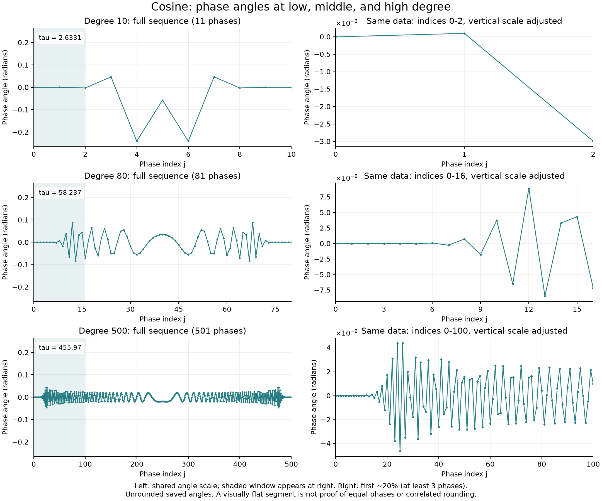
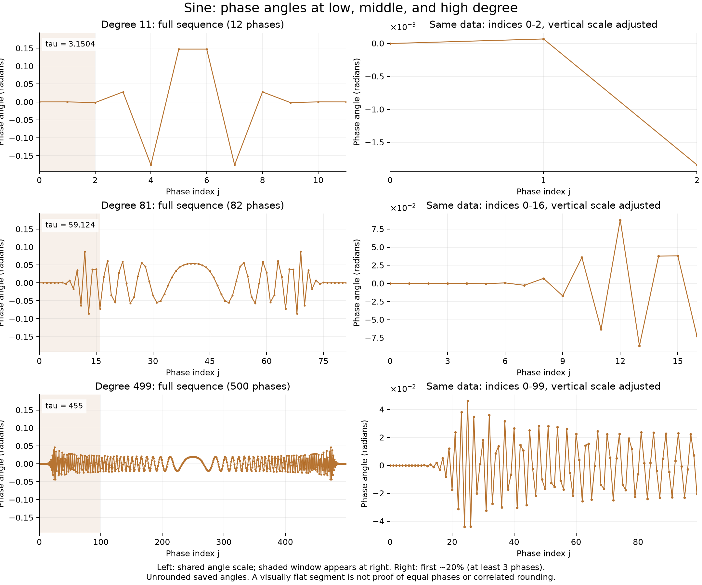
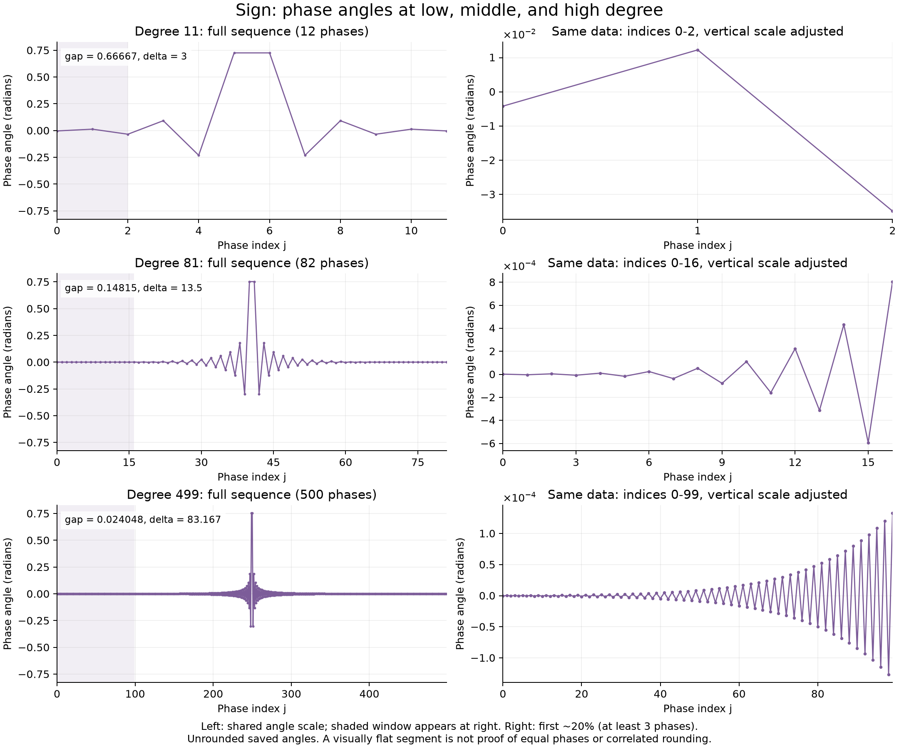

# Stage 2 representative phase-angle plots

These figures address the original Stage 2 request to plot a few phase lists against phase index and note long runs of nearly equal values. They use nine existing pyqsp phase lists: low, middle, and high degree for cosine, sine, and sign. No phases were synthesized, wrapped, or rounded for this addition.

## How to read them

Each row is one saved case. The left panel shows every phase angle against its actual index, using a common vertical scale within the family. The shaded region is shown again at right with its own vertical scale. The zoom always uses the first approximately 20% of the list, with at least three phases; it was not selected by searching for a plateau.

The right panel checks whether an apparently flat edge is actually constant or simply small relative to the central phases. A plateau means a consecutive run of nearly equal angles. Visual flatness depends on the axis scale and does not establish numerical equality or related rounding errors.

Degree and target difficulty both change between rows. These are descriptive examples, not a controlled experiment isolating degree.

## Cosine: degrees 10, 80, and 500



## Sine: degrees 11, 81, and 499



## Sign: degrees 11, 81, and 499



## Observation and boundary

The edge zooms show small, varying angles rather than establishing a long constant segment. At the previously recorded adjacent-difference threshold of 1e-8 radians, the selected cosine lists have longest runs of one phase, and the selected sine/sign lists have longest runs of two phases: their exactly repeated center pair. This threshold is a descriptive implementation choice, not a professor-specified definition of a plateau. Changing the threshold can change the classification.

The original overview's median neighboring-phase-change panel remains an optional summary of typical differences across degrees. It does not locate plateaus and is not a substitute for these phase-index plots. No panel was removed.

Equal phases have equal errors under direct nearest rounding on a common grid, but nearby phases need not have equal errors. Actual rounding-error autocorrelation, phase sensitivities, and degree-scaling fits remain later Stage 4/5 work. No conclusions about coherent accumulation or noise-shaping benefit follow from these figures alone. Original MATLAB execution and the supervisor checkpoint remain pending.

## Data and regeneration

- [Original full-precision phase library](../data/phases/README.md)
- [Exact plotted values](../results/stage2/phase_structure/phase_points.csv)
- [Selected cases, window limits, measurements, and source/figure hashes](../results/stage2/phase_structure/summary.json)
- [Plotting script](../experiments/stage2/plot_phase_structure.py)

From the repository root in the pinned validation environment:

```powershell
.\.venv\Scripts\python.exe experiments/stage2/plot_phase_structure.py
```

The script verifies each selected archive against the saved manifest, confirms the phase count and unrounded convention, and checks its adjacent-run statistic against the archive before writing the figures. The plots do not modify the baseline phase files, manifest, or original overview.
