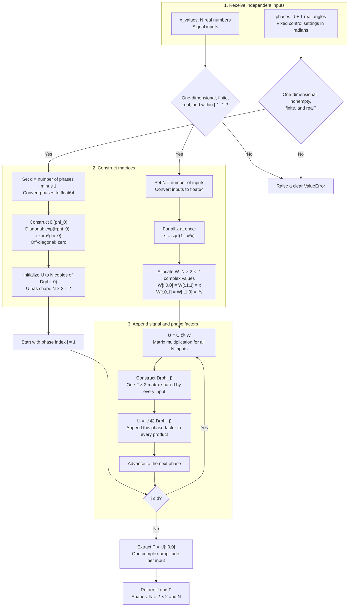

# Stage 1: forward QSP evaluation and conventions

**Part A implemented:** evaluate a supplied phase list at many signal inputs. **Part B pending:** reproduce 2–3 pyqsp examples, complete mathematical validation across degrees, and write the one-page pyqsp/QSPPACK convention mapping. The basic Part A checks do not establish completion of Stage 1.

## Part A: inputs, convention, and outputs

`evaluate_qsp(phases, x_values)` returns `(U, P)`. The inputs are independent:

- `phases`: a nonempty one-dimensional sequence of finite real angles in radians. The same list is used for every signal input.
- `x_values`: a one-dimensional sequence of finite real inputs in $[-1,1]$. Input order is preserved; an empty sequence is supported. Scalars, complex values, and out-of-domain inputs are rejected rather than clipped.

For $d+1$ phases, use the $W_x$ signal / $Z$ phase convention:

$$
D(\phi)=e^{i\phi Z}=\begin{pmatrix}e^{i\phi}&0\\0&e^{-i\phi}\end{pmatrix},
\qquad
W(x)=\begin{pmatrix}x&i\sqrt{1-x^2}\\i\sqrt{1-x^2}&x\end{pmatrix}.
$$

$$
U_\Phi(x)=D(\phi_0)W(x)D(\phi_1)\cdots W(x)D(\phi_d),
\qquad P_\Phi(x)=[U_\Phi(x)]_{00}.
$$

There are $d$ signal factors and $d+1$ phase factors, or $2d+1$ matrices total. The signal angle is $\theta=\arccos x$; it is not one of the control phases $\phi_j$. The implementation uses $\sqrt{1-x^2}$ directly and need not calculate $\theta$.

- `U`: `complex128`, shape `(N, 2, 2)`, the complete matrix at every input.
- `P`: `complex128`, shape `(N,)`, its upper-left entry, a polynomial amplitude of degree at most $d$. This is a view into `U`; copy it before independent modification.
- The evaluator returns the complex amplitude, not a probability or a solver-specific real/imaginary readout. Phases are not rounded or wrapped.

## Part A implementation map



`@` denotes matrix multiplication, not elementwise multiplication. The implementation iterates directly over `phases[1:]`; the diagram's index is the equivalent pseudocode. All input values are processed together. The written product is assembled by appending factors on the right; when applied to a column state, the rightmost matrix acts first. Degree zero naturally skips the loop and returns copies of the sole phase matrix.

Work scales as $O(Nd)$ for positive degree, plus $O(N+d)$ setup, with $O(N+d)$ total storage including converted inputs. Working matrix storage is $O(N)$; the evaluator does not save intermediate products for each phase.

## Run Part A

From the repository root:

```shell
python -m pip install -e .
python -m unittest discover -s tests/stage1 -v
```

```python
import numpy as np
from qsp_finite_precision.stage1 import evaluate_qsp

x = np.linspace(-1, 1, 101)
U, P = evaluate_qsp([0.2, 0.7, -0.4], x)
print(U.shape, P.shape)  # (101, 2, 2) (101,)
```

The core checks cover analytic degree-zero and degree-one matrices, a degree-two polynomial, batched versus scalar trigonometric evaluation, empty input shapes, and invalid inputs. The scalar comparison uses a separate input loop and explicit entries for each combined signal/phase factor. It is an implementation check, not a solver comparison. Development verification uses Python 3.11 and NumPy 2.3.3.

## Part B: remaining Stage 1 work

- Reproduce 2–3 built-in pyqsp examples using identical phases, inputs, and matching readouts.
- Check random-list unitarity, the endpoint sum identity, boundedness, parity, and the all-zero-phase Chebyshev identity across representative degrees.
- Record numerical discrepancies, justified tolerances, response plots, and solver versions.
- Complete the one-page convention note and verify the pyqsp and QSPPACK mappings before using solver phases in later stages. The project-wide tracking note is [Conventions](../../../notes/Conventions.md).

## Boundary with later stages

This stage evaluates supplied phases. Stage 2 will generate and archive solver phase lists; Stage 3 will quantize them; Stage 4 will measure errors; Stage 5 will analyze scaling. Later stages should import this evaluator rather than duplicate it. See the [project stage map](../../../README.md#stage-map).
