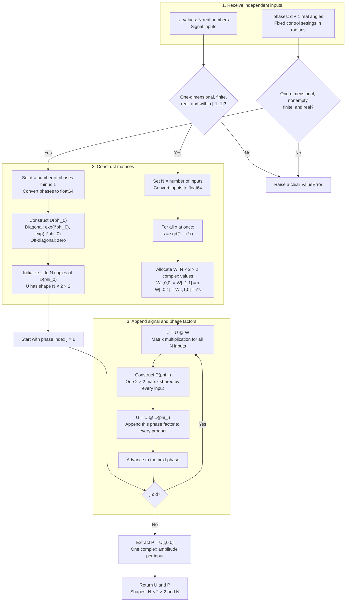
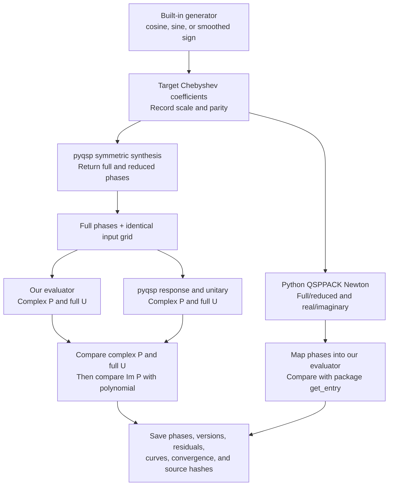
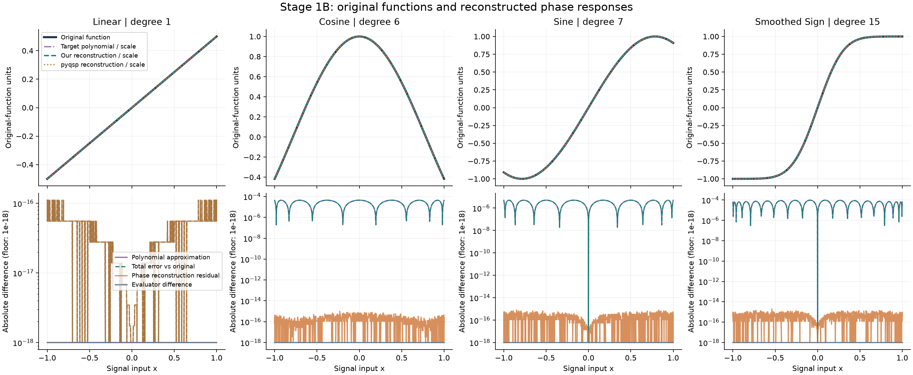

# Stage 1: forward QSP evaluation and conventions

**Parts A and B implemented and validated for the pinned Python packages.** The evaluator reproduces three built-in pyqsp examples plus a linear diagnostic, and the convention adapters agree with Python QSPPACK's full/reduced and real/imaginary readouts. Sampled mathematical checks pass through degree 500. The original MATLAB QSPPACK mapping was source-inspected; MATLAB execution remains a Stage 2 cross-check. These results validate the stated implementations on sampled cases, not every input or future high-degree solver case.

## Part A: inputs, convention, and outputs

`evaluate_qsp(phases, x_values)` returns `(U, P)`. The inputs are independent:

- `phases`: a nonempty one-dimensional sequence of finite real angles in radians. The same list is used for every signal input.
- `x_values`: a one-dimensional sequence of finite real inputs in $[-1,1]$. Input order is preserved; an empty sequence is supported. Scalars, complex values, and out-of-domain inputs are rejected rather than clipped.

For $d+1$ phases, use the $W_x$ signal / $Z$ phase convention:

$$
D(\phi)=e^{i\phi Z}=\begin{pmatrix}e^{i\phi}&0\\0&e^{-i\phi}\end{pmatrix},
\qquad
W(x)=\begin{pmatrix}x&i\sqrt{1-x^2}\\i\sqrt{1-x^2}&x\end{pmatrix}.
$$

$$
U_\Phi(x)=D(\phi_0)W(x)D(\phi_1)\cdots W(x)D(\phi_d),
\qquad P_\Phi(x)=[U_\Phi(x)]_{00}.
$$

There are $d$ signal factors and $d+1$ phase factors, or $2d+1$ matrices total. The signal angle is $\theta=\arccos x$; it is not one of the control phases $\phi_j$. The implementation uses $\sqrt{1-x^2}$ directly and need not calculate $\theta$.

- `U`: `complex128`, shape `(N, 2, 2)`, the complete matrix at every input.
- `P`: `complex128`, shape `(N,)`, its upper-left entry, a polynomial amplitude of degree at most $d$. This is a view into `U`; copy it before independent modification.
- The evaluator returns the complex amplitude, not a probability or a solver-specific real/imaginary readout. Phases are not rounded or wrapped.

## Part A implementation map



`@` denotes matrix multiplication, not elementwise multiplication. The implementation iterates directly over `phases[1:]`; the diagram's index is the equivalent pseudocode. All input values are processed together. The written product is assembled by appending factors on the right; when applied to a column state, the rightmost matrix acts first. Degree zero naturally skips the loop and returns copies of the sole phase matrix.

Work scales as $O(Nd)$ for positive degree, plus $O(N+d)$ setup, with $O(N+d)$ total storage including converted inputs. Working matrix storage is $O(N)$; the evaluator does not save intermediate products for each phase.

## Run Part A

From the repository root:

```shell
python -m pip install -e .
python -m unittest discover -s tests/stage1 -v
```

```python
import numpy as np
from qsp_finite_precision.stage1 import evaluate_qsp

x = np.linspace(-1, 1, 101)
U, P = evaluate_qsp([0.2, 0.7, -0.4], x)
print(U.shape, P.shape)  # (101, 2, 2) (101,)
```

The six core checks cover analytic degree-zero and degree-one matrices, a degree-two polynomial, batched versus scalar trigonometric evaluation, empty input shapes, and invalid inputs. The scalar comparison uses a separate input loop and explicit entries for each combined signal/phase factor. Six additional convention/integration tests are in `test_conventions.py`. Development verification uses Python 3.11; the latest full validation run uses NumPy 2.4.6.

## Part B: mathematical checks

Run the reproducible identity experiment from the repository root:

```shell
python experiments/stage1/check_identities.py
```

The [experiment script](../../../experiments/stage1/check_identities.py) writes [the results table](../../../results/stage1/mathematical_checks.csv). It checks degrees 0, 1, 2, 3, 10, 31, 100, and 500, with three random phase lists per degree (seed 20261022). Each list is evaluated at 513 Chebyshev-Lobatto inputs including both endpoints. Each degree also gets an all-zero-phase check against NumPy's Chebyshev recurrence. The random-list checks cover unitarity, the endpoint identity, boundedness, and parity: 104 recorded checks total, in addition to the six Part A unit tests.

First run: all 104 checks passed using NumPy 2.3.3. Re-run with NumPy 2.4.6: all passed with the same largest discrepancies. Largest observed discrepancies:

| Check | Discrepancy measured | Largest value |
| --- | --- | --- |
| Unitarity | Spectral norm of $U^\dagger U-I$ | 8.50e-14 |
| Endpoint phase sum | Spectral norm of $U(1)-\exp(iZ\sum_j\phi_j)$ | 1.43e-14 |
| Boundedness | Positive excess of $|P(x)|$ above 1 | 8.88e-16 |
| Parity | Absolute difference between $P(-x)$ and $(-1)^dP(x)$ | 0 in this run |
| Zero-phase Chebyshev identity | Absolute difference between $P_{\mathbf0}(x)$ and $T_d(x)$ | 1.64e-13 |

The absolute pass threshold is a conservative 1e-10 for this experiment, not a theoretical error bound or a measured accuracy floor. These are finite sampled checks, not a proof over all phase lists and input values. Chebyshev comparison includes numerical error in the reference recurrence as well as the evaluator. Exact parity agreement is specific to this implementation and tested inputs; the table does not establish arbitrary-precision accuracy or package-convention agreement.

## Part B: solver comparisons and conventions

[The Stage 1B README](../../../experiments/stage1/README.md) contains the **individual reference graphs and maximum/RMSE error tables for every example**, including each Python QSPPACK readout, plus regeneration instructions and the dependency lock. Each graph shows the original function, target polynomial, phase-reconstructed response, full phase sequence, and separate approximation/reconstruction errors. Run `python experiments/stage1/compare_solvers.py` in that environment. The [convention note](../../../notes/Conventions.md) specifies coefficient ordering, phase signs, symmetric expansion, endpoint offsets, and selected amplitudes.



| Example | Degree | Maximum complex P difference vs pyqsp | Evaluated target-polynomial residual |
| --- | --- | --- | --- |
| Linear diagnostic, 0.5x, scale=1 | 1 | 0 | 1.11e-16 |
| Cosine, tau=2, epsilon=1e-3, scale=0.5 | 6 | 0 | 5.00e-16 |
| Sine, tau=2, epsilon=1e-3, scale=0.5 | 7 | 0 | 3.89e-16 |
| Smoothed sign, delta=3, maximum-scale option=0.9 | 15 | 0 | 1.78e-15 |

Each uses 1,025 inputs: 513 Chebyshev-Lobatto points including exact zero and both endpoints, plus 512 uniform midpoints. Full-unitary differences were also zero on these examples. All 16 Python QSPPACK synthesis/readout combinations converged and matched the mapped evaluator within 8.89e-16. The [JSON report](../../../results/stage1/solver_comparisons.json) stores actual phases, scales, thresholds, native scaled residuals, and original-function error statistics; the [CSV](../../../results/stage1/solver_responses.csv) stores the curves and pointwise errors.

The overview below uses original-function units: the polynomial and reconstructed readouts are divided by the generator scale (0.5 for cosine/sine, approximately 0.89997 for the erf example, and 1 for the linear diagnostic). This display conversion makes comparison with the original functions meaningful. Native circuit-unit residuals in the table above are retained separately. For the individual phase plots and detailed error tables, see the [Stage 1B reference graphs](../../../experiments/stage1/README.md#reference-graphs-and-error-metrics).



Agreement to a polynomial is distinct from approximation of the underlying function. The built-in sign example uses a smooth erf surrogate; the core gap-domain sign targets remain Stage 2 work. No phases were quantized, the packages share algorithmic lineage, and these low-degree solver comparisons do not establish a rigorous accuracy floor. MATLAB QSPPACK has not been executed.

## Boundary with later stages

This stage evaluates supplied phases. Stage 2 now generates and archives the core solver phase lists. After the supervisor checkpoint, Stage 3 will quantize them, Stage 4 will measure errors, and Stage 5 will analyze scaling. The [identity-check figure](../../../figures/stage1/mathematical_checks.png) makes the existing mathematical diagnostics visible alongside their CSV. Later stages import this evaluator rather than duplicate it. See the [project stage map](../../../README.md#stage-map).
