# Stage 2: full-precision core phase library

The Python deliverables are complete: realistic solver-generated phase lists for both core application families, residuals, graphs, data, and regeneration evidence. Original MATLAB QSPPACK execution was **unable to complete** because MATLAB Online disconnected before code execution; [the attempt record](../../../results/stage2/matlab_execution_status.json) preserves that limitation. Professor Hen's supervisor checkpoint remains pending, and Stage 3 has not started.

[Measured summary in the project README](../../../README.md#stage-2-measured-baseline-results) · [Browse all cases and graphs](../../../data/phases/README.md) · [Summary CSV](../../../results/stage2/library_summary.csv) · [Manifest](../../../results/stage2/summary.json) · [Reload verification](../../../results/stage2/verification.json)

The authoritative requirements are “Stage 2: a library of real phase lists” and “Checkpoint” in [Professor Hen's original description](../../../references/QSP_project.docx). The target parameters and numerical acceptance thresholds below are implementation choices that make those requirements reproducible; they are not additional instructions from the professor.

## Inputs, outputs, and workflow

```mermaid
flowchart TD
    SPEC["Original assignment<br/>Two core families, degrees about 10 to 500"] --> CFG["Pinned configuration and package versions"]
    subgraph TARGETS["Construct and record each target"]
        CFG --> HAM["Cosine and sine<br/>Jacobi-Anger coefficients, scale 0.5, varied evolution time"]
        CFG --> SIGN["Sign target, maximum 0.9<br/>Erf surrogate, DCT coefficients, varied excluded gap"]
        HAM --> POLY["Save actual degree, parity, coefficients,<br/>target scale, domain, and approximation error"]
        SIGN --> POLY
        POLY --> BOUND["Full-interval boundedness estimate<br/>Theta grid plus between-node allowance"]
    end
    subgraph PYTHON["Primary baseline and Python checks"]
        BOUND --> SOLVE["Production pyqsp symmetric Newton solver<br/>Unrounded full and reduced phases"]
        SOLVE --> COEF["Check convergence and recompute<br/>returned-phase coefficient L1 residual"]
        COEF --> EVAL["Local full-unitary and complex-amplitude evaluation<br/>Full validation grid and separate package audit grid"]
        EVAL --> OWN["Same phases and inputs in pyqsp<br/>Compare complete complex amplitude"]
        OWN --> PORT["Supplementary Python QSPPACK solve<br/>Compare its own real readout with local evaluation"]
        PORT --> PYOK{"All Python checks pass?"}
        PYOK -- No --> FAIL["Record failure; do not mark complete"]
        PYOK -- Yes --> ARCH["Phase JSON, response and audit CSVs, solver logs<br/>Metadata, numerical settings, and file hashes"]
    end
    subgraph MATLAB["Original MATLAB QSPPACK cross-check"]
        ARCH --> BUNDLE["Export the same coefficients and both input grids<br/>Package pinned original source and source hashes"]
        BUNDLE --> RUNTIME["Run in actual MATLAB or MATLAB Online<br/>Verify runtime, input hash, and six source hashes"]
        RUNTIME --> FIXTURES["Eight Stage 1 full-phase checks<br/>Four fixtures, real and imaginary target readouts"]
        RUNTIME -- Cannot connect --> UNAVAILABLE["Record unable_to_complete and executed=false<br/>Keep prepared code separate from numerical evidence"]
        FIXTURES --> CORE["Solve all 21 core polynomials<br/>Save MATLAB phases, native full-grid responses, and residuals"]
        CORE --> CROSS["Reconstruct the same MATLAB phases in Python<br/>Compare native/local readouts, polynomial, target, and unitarity"]
        CROSS --> MATOK{"Complete coverage, convergence,<br/>and numerical tolerances pass?"}
        MATOK -- No --> FAIL
    end
    MATOK -- Yes --> PUB["Publish actual MATLAB CSVs, phase archives,<br/>per-case graphs, overview, and measurable README results"]
    ARCH --> RELOAD["Reload all archived phases<br/>Recompute saved curves, domains, and metrics"]
    RELOAD --> CLEAN["Separate-clone regeneration<br/>Match scientific source identity, phases, and curves"]
    PUB --> AUDIT["Audit artifact hashes, data/figure coverage,<br/>documentation links, and repository status"]
    CLEAN --> AUDIT
    UNAVAILABLE --> AUDIT
    AUDIT --> READY{"All technical requirements executed and passed?"}
    READY -- Yes --> DONE["Stage 2 technical deliverables complete<br/>Only after all required executed checks pass"]
    READY -- No --> LIMITED["Deliver validated Python work and disclose unavailable check<br/>Full technical completion remains false"]
    DONE --> REVIEW["Separate supervisor checkpoint<br/>Conventions, solver reproduction, core library, and regeneration"]
    LIMITED --> REVIEW
    REVIEW --> APPROVED{"Professor review recorded?"}
    APPROVED -- No --> WAIT["Stage 3 remains blocked"]
    APPROVED -- Yes --> NEXT["Stage 3: quantize the same saved baseline phases"]
```

Implementation files:

- `targets.py`: core target definitions, Jacobi–Anger / erf polynomial construction, parity, domain, and boundedness estimates.
- `library.py`: production-solver calls, independent returned-phase checks, full-precision archives, residuals, and supplementary Python QSPPACK evaluation.
- [build_library.py](../../../experiments/stage2/build_library.py): regeneration, per-case figures, tables, manifest, and summary.
- [verify_library.py](../../../experiments/stage2/verify_library.py): re-evaluate the saved phases without repeating phase synthesis.
- [crosscheck_matlab.m](../../../experiments/stage2/crosscheck_matlab.m): execute original QSPPACK, record eight Stage 1 full-phase readout checks and all 21 full-grid core responses, and save completed cases for resumption.
- [verify_matlab.py](../../../experiments/stage2/verify_matlab.py): reject source/input/coverage/convergence/convention mismatches and verify actual MATLAB data on both grids.
- [publish_matlab.py](../../../experiments/stage2/publish_matlab.py): prepared publication step for verified actual results; produces per-case CSVs, full phase archives, comparison graphs, an overview, and updated status. No MATLAB results are manufactured by this code.

## Chosen core cases

The [configuration](../../../experiments/stage2/config.json) requests:

| Waveform | Achieved degrees requested | Parameterization | Desired target / application domain |
| --- | --- | --- | --- |
| Cosine | 10, 20, 40, 80, 160, 320, 500 | Choose evolution time so the numerically summed omitted Jacobi–Anger coefficient tail is 1e-7 | $0.5\cos(\tau x)$ on $[-1,1]$ |
| Sine | 11, 21, 41, 81, 161, 321, 499 | Same omitted-tail target, with odd degrees | $0.5\sin(\tau x)$ on $[-1,1]$ |
| Sign | 11, 21, 41, 81, 161, 321, 499 | $\delta=\max(3,d/6)$; gap $\gamma=2/\delta$ | $0.9\operatorname{sign}(x)$ on $[-1,-\gamma]\cup[\gamma,1]$ |

Cosine and sine are the two waveforms in the Hamiltonian-simulation family; sign is the second required family. Degree parity is preserved, so the odd sequences end near 500 at 499. Leading coefficients are retained rather than padding lower-degree examples with zeros. Actual degrees, phase counts, and target parameters are stored per case.

For Hamiltonian cases the coefficients come directly from Bessel-function Jacobi–Anger expansions. The omitted-tail sum is a numerical estimate over 512 omitted active-parity coefficients, not a rigorous infinite-tail certificate. Actual target errors are checked independently on the validation grid. The 0.5 scale keeps the target comfortably inside the admissible range.

For sign cases the construction starts with a Chebyshev expansion of the smooth surrogate $\operatorname{erf}(\delta x)$. A DCT-II on first-kind Chebyshev nodes gives coefficients; opposite-parity coefficients are set to zero, and the degree-$d$ truncation is scaled to stay below 0.9 using the recorded global-bound estimate. Coefficients are compared with those from twice as many samples to expose finite-sampling sensitivity.

**The sign target remains $0.9\operatorname{sign}(x)$.** Its approximation and baseline errors are measured against that discontinuous target on the gap-excluded domain, not against the erf surrogate. Gap edges are included exactly in the evaluation grid. The native target scale is 0.9; the polynomial-construction scale can be slightly smaller and is recorded separately.

Target difficulty changes with degree: evolution time increases and the sign gap shrinks. These are realistic family sweeps at the stated construction settings. Future degree-scaling interpretations must account for that parameter covariation; the library does not establish an isolated causal degree effect.

## Boundedness assessment

For a real Chebyshev polynomial, set $q(\theta)=p(\cos\theta)$. Its second derivative obeys

$$
|q''(\theta)|\le M_2=\sum_{k=0}^{d}k^2|c_k|.
$$

With an endpoint-including uniform theta grid of spacing $\Delta\theta$, an interior maximum of $|q|$ is stationary and lies within $\Delta\theta/2$ of a sample. Taylor's bound then gives

$$
\max|p|\le \max_{\text{samples}}|p|+\frac{M_2\Delta\theta^2}{8}
$$

in exact arithmetic. The code uses at least 8,193 points (or $64d+1$), adds a floating-point margin, and records every term. This is stronger than a sampled maximum alone, but it is a **numerical upper estimate, not a directed-rounding interval certificate**. Sign scaling includes a small additional safety margin. Cosine/sine estimates must be below one; sign estimates must be at most 0.9 within the stated numerical allowance.

## Residuals, grids, and pass criteria

Let $f$ include the desired amplitude scale, $p$ be the supplied polynomial, and $r=\operatorname{Im}P$ the pyqsp phase response. Native circuit-unit metrics are:

- Approximation: maximum and sample-weighted RMSE of $p-f$ on the application domain.
- Synthesis: maximum and sample-weighted RMSE of $r-p$ on the full signal interval.
- Baseline: maximum and sample-weighted RMSE of $r-f$ on the application domain.
- Package agreement: complex $P$ from our evaluator versus pyqsp's own response, with identical phases and audit inputs.
- Supplementary Python QSPPACK: real-part response for its own full phases versus its own `get_entry`, plus synthesis / target residuals.
- Structural checks: full phase count, unitarity, polynomial boundedness, and descriptive phase symmetry/adjacency measurements.

Each validation grid has at least 2,049 Chebyshev-Lobatto samples or $10d+1$, whichever is larger, plus uniform interior midpoints and exact gap edges. The separate package audit grid includes Chebyshev points, interior points, endpoints, zero, and sign-gap edges. The full validation-grid curves and audit-grid responses are archived separately. All reported maxima are sampled maxima. RMSE gives equal weight to the actual samples and is not a uniform-domain integral norm.

Acceptance choices:

| Check | Acceptance |
| --- | --- |
| pyqsp stopping residual and independently recomputed returned-phase coefficient L1 residual | Both below 1e-12 |
| Response-to-polynomial error, package-evaluator agreement, and unitarity residual | At most 1e-10 |
| Cosine/sine baseline target error | At most 1e-6 |
| Sign baseline target error on the declared application domain | At most 1e-2 |
| Python QSPPACK | Converged, and passes the same response checks |

The installed pyqsp high-level symmetric wrapper omits convergence metadata. We call its documented `sym_qsp_opt.newton_solver` directly, using the same production algorithm, and record both its pre-update stopping residual and a fresh residual from the returned phases. A failed case is recorded in the manifest and is not saved as a successful phase archive.

These tolerances are regression and library-acceptance settings, not measured accuracy floors. Floating-point evaluation contributes to the measured synthesis residual. No rounding-error conclusion follows from these baseline numbers.

## Saved data and figures

Each successful case has:

- `data/phases/stage2/<case>.json`: target, coefficients, all full/reduced phases, conventions, scales, domains, versions/options, convergence, metrics, and artifact hashes. Python's full float representation preserves binary64 round-trip values. No phase wrapping or quantization is applied.
- `results/stage2/<case>_response.csv`: validation inputs, scaled target, polynomial, reconstructed real/imaginary amplitude, application mask, Python QSPPACK readout, and separate errors. Values inside a sign gap are retained for diagnostics but excluded from application-error metrics.
- `results/stage2/<case>_audit.csv`: each package's own response versus the corresponding local response on the audit grid.
- `results/stage2/<case>_solver.log`: solver iteration output.
- `figures/stage2/<case>.png`: original function / reconstruction, full phase sequence, separated errors, and max/RMSE table. Curves are displayed in original-function units by dividing by the target scale; metric tables retain native circuit units.

The overview plots residuals, target parameters, and median neighboring phase changes. High-frequency Hamiltonian response panels use a central zoom with a full-interval inset; the errors and archived curves still cover the full validation grid. “Nearly equal adjacent” in the archive means an absolute neighboring phase difference at most 1e-8 radians; its threshold and longest run are recorded. At that particular threshold, the current cosine lists have no such adjacent pairs; the odd-degree sine/sign lists have only the forced duplicated center pair from symmetric expansion (longest run two). This does not establish extended phase plateaus or rounding correlations. Other thresholds could give different descriptive counts.

## Original MATLAB QSPPACK and completion boundary

The [checkpoint guide](../../../notes/Stage%202%20-%20Checkpoint%20Guide.md) collects the review evidence. [Clean-clone regeneration](../../../results/stage2/rebuild_comparison.json) reproduced all 21 cases with zero differences in compared phases and curves. A [portable ZIP](../../../results/stage2/qsp-stage2-matlab.zip) now includes the original pinned QSPPACK source, license, all inputs, and the MATLAB runner for local or online use.

The original MATLAB runtime is unavailable locally, and the free online session failed before code execution. On 2026-10-24 Anish authorized documenting this check as unable to complete and proceeding with cleanup. [The supplied runner](../../../experiments/stage2/crosscheck_matlab.m) consumes exported coefficients and both input grids, checks six original MATLAB source hashes, and is prepared to save phases and native responses. [The verifier](../../../experiments/stage2/verify_matlab.py) checks actual reports. No original MATLAB numerical results or MATLAB-derived graphs are claimed. Python QSPPACK has shared algorithmic lineage and remains supplementary.

The manifest currently retains `stage2_complete: false`, pending original MATLAB execution. The prepared publisher sets `technical_complete` and `stage2_complete` only after the actual report passes and its data/figures are published. These fields describe technical Stage 2 completion. The supervisor checkpoint is tracked separately and must remain pending until review is recorded; `ready_for_stage3` remains false. Before Stage 3, review the Stage 1 convention note, reproduced solver outputs, and this regenerable library with Professor Hen.

The successful Python checks and MATLAB cross-check have different roles from the later numerical-precision assessment. Rounding error will compare each rounded response with its **own unrounded baseline**. Existing function-approximation and solver residuals stay separate. Ordinary-precision package agreement does not certify how small a rounding effect can be resolved; the assignment's Stage 4 high-degree checks with at least 30-digit mpmath remain future work.

## Sources

- [Original assignment](../../../references/QSP_project.docx), Stage 2 and checkpoint.
- [pyqsp README](https://github.com/ichuang/pyqsp): symmetric readout and documented direct Newton interface; installed version 0.2.0 is used.
- [Original MATLAB QSPPACK](https://github.com/qsppack/QSPPACK/tree/7bc7b7622e05039e4c2cdda7d5739e99c3752be6) and [Python QSPPACK documentation](https://qsppack.readthedocs.io/en/latest/getting_started.html).
- [Concept guide](../../../notes/Stage%202%20-%20Phase%20Library%20Concept.md) and [convention note](../../../notes/Conventions.md).
